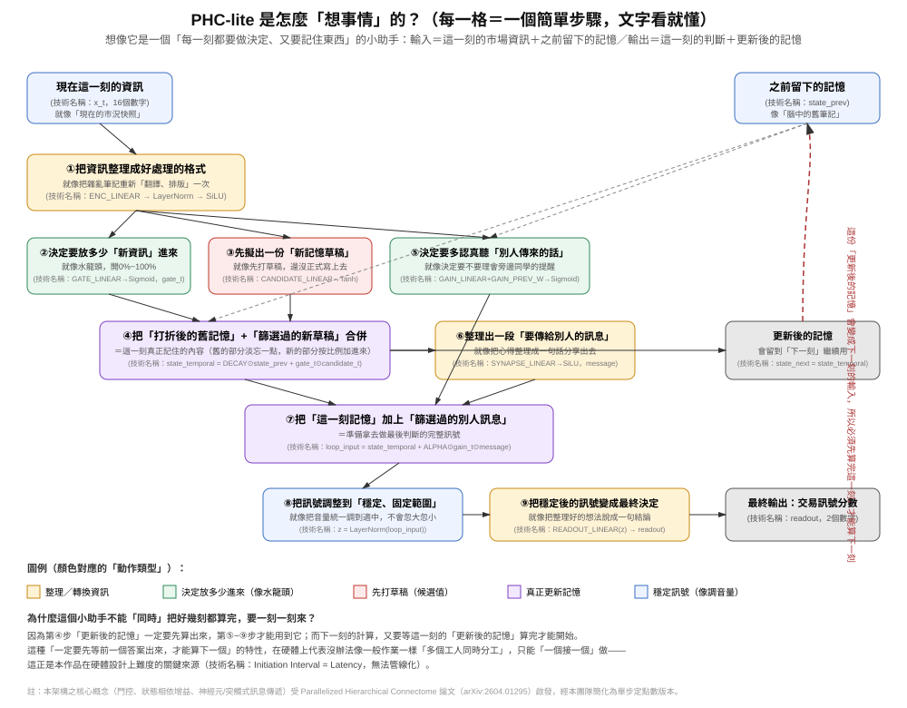
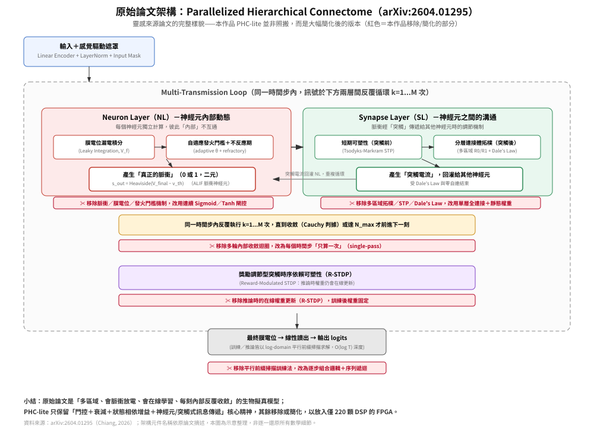

作品名稱：確定性低延遲推論核心——資源受限FPGA上遞迴神經網路之手動HLS實現與驗證
參賽組別：AMD Track（不定題組）
隊伍代號：ZeroJitter

---

## 一、摘要

本作品已完成從 C 模擬、C/RTL 共模擬到 Vivado 實體佈局繞線（P&R）的全鏈路硬體驗證，並取得時序達標的實體電路實測結果（WNS=+0.020 ns）——本文呈現的是已被工具鏈與實體電路證實可行的設計，數據皆可追溯至實際工具輸出紀錄。

高頻交易（HFT）系統對推論延遲的「確定性」要求，往往高於對平均延遲本身的要求；CPU 推論路徑受作業系統排程、GC、快取失效影響，尾端延遲（tail latency）波動極大。本作品實證回答兩個問題：（1）具備跨時間步狀態依賴的遞迴神經網路，能否在資源極受限的 FPGA（AMD/Xilinx Zynq-7020，僅 220 顆 DSP、53,200 個 LUT）上完成 HLS 並通過實體 P&R；（2）其延遲特性優勢具體展現在何處。第一個問題答案是已實測確認的「是」；第二個問題的答案精確指向「尾端延遲與確定性」而非「平均速度」。

本作品以「PHC-lite」——核心概念受 Parallelized Hierarchical Connectome（PHC）空間遞迴框架啟發（Chiang, 2026，參考文獻3），經本團隊大幅簡化為單步、純定點數運算之遞迴狀態空間模型 PHCSSM（保留門控、衰減、狀態相依增益機制，移除原框架之脈衝神經元與多區域連接體拓樸）——作為實驗對象，以手動 Vitis HLS（而非自動化工具 hls4ml）實作其推論核心；三次以 hls4ml 自動轉換失敗的具體原因詳見第二項。歷經 8 輪資源除錯，最終版本通過 C 模擬（25,600 組測試向量、0 mismatch）、C/RTL 共模擬（bit-level 與 C 模型完全一致）、Vivado 實體 P&R（timing met，WNS=+0.020 ns），post-route 資源用量 LUT 14.20%／FF 7.72%／DSP48E1 21.36%／BRAM_18K 2.14%，全部在預算內。與 PyTorch CPU 基準比較，FPGA 固定延遲 83.16 µs，CPU 路徑 p99 延遲 778.8 µs，尾端延遲改善達 9.4 倍，且抖動為零。

本作品不宣稱已達成可部署的生產級 HFT 系統，亦不宣稱 FPGA 改善了交易 PnL（未進行任何交易回測）；目的是以可重現的工程數據，展示資源受限 FPGA 上遞迴神經網路 HLS 實作的可行性與系統化優化方法論，並提出明確的下一階段工作計畫。

---

## 二、動機及相關技術

### 2.1 設計動機

FPGA 在金融交易硬體加速領域已有公開文獻佐證其低延遲優勢，例如 cuckoo hashing 訂單簿查詢可達平均 253 ns 延遲［參考文獻4］，多篇文獻指出 FPGA 加速可降低 70% 以上延遲［參考文獻5、6］。然而既有工作多聚焦「訂單簿維護」與「封包解析」此類確定性邏輯運算，較少涉及同時具備非線性運算與跨時間步狀態依賴的「遞迴神經網路推論」。本作品的動機即填補此落差：驗證具備門控、衰減、LayerNorm 機制的遞迴模型，能否在最入門等級 FPGA 上完成完整軟硬體驗證鏈。

### 2.2 技術選型與失敗經驗：為何放棄 hls4ml，改採手動 HLS

hls4ml（Duarte et al., 2018［參考文獻1］）為學術界最成熟之「PyTorch/Keras 自動轉 HLS」工具鏈，亦有文獻證明可支援 GRU/LSTM（Aarrestad et al., 2022［參考文獻2］）。本團隊以 hls4ml 1.3.0 對三種模型變體進行轉換嘗試，三次嘗試**全部在 Python 端模型解析階段即失敗**，從未產生 C++ 專案或執行 Vivado 合成：

| 嘗試對象 | 失敗原因（依工具實際錯誤訊息） |
|---|---|
| TCN（3-block dilated） | `ConstantPad1d` layer 之 parser 失敗 |
| TCN（5-block prepad） | `torch.fx` 符號追蹤於控制流處丟出 `TraceError` |
| PHC-STP 單步模型（LayerNorm） | PyTorch frontend 明確拒絕 2D LayerNorm 輸入；改 3D 輸入仍失敗；改 ONNX 路徑於 shape 推斷階段失敗 |

三條轉換路徑皆已嘗試、全數失敗，指出自動化工具鏈在「含 LayerNorm 與跨時間步遞迴依賴」架構上的當前邊界，而非單純設定錯誤。據此，本作品選擇手動 Vitis HLS 重新實作模型數學定義，換取對每一個運算節點與資源用量決策的完全控制權。

### 2.3 技術創新與改良：資源收斂成果與三項根本原因修復

本作品將 DSP 用量自最初設計的 2636%（超出平台容量，無法合成）收斂至最終 21%，LUT 由 2073% 收斂至 46%（csynth 估計值，實際 P&R 後為 14.20%），且每一步收斂皆對應一個經工具官方診斷訊息證實的根本原因，而非反覆試誤的偶然結果：

1. `tanh()` 在 HLS 中被合成為雙精度浮點核心，單次呼叫耗用約 2,048 顆 DSP；修復方式為 65 點分段線性定點查表取代。
2. `#pragma HLS PIPELINE II=X` 觸發 Vitis HLS 自動將部分展開強制升格為完全展開（`[HLS 214-275]`／`[HLS 214-376]`）；修復方式為移除頂層 PIPELINE pragma。
3. 移除後，全域 `pipeline_loops` 門檻仍自動對少迭代迴圈套用 pipeline 化並連鎖觸發強制展開（`[HLS 214-291]`／`[HLS 214-449]`）；修復方式為對受影響迴圈明確加上 `#pragma HLS PIPELINE off`。

三項根本原因皆透過工具官方診斷訊息逐一確認，而非事後推測。

### 2.4 成果定位：與典型 FPGA 創意應用作品的本質差異

本作品交付的成果是：在無法管線化的遞迴架構限制下（II=Latency），於僅 220 顆 DSP 的入門級平台上，將 DSP 收斂至 21%、LUT 14.20%、FF 7.72%，並通過實體 P&R 時序驗證。多數 FPGA 創意應用作品（如 CNN 影像分類）在數學上前饋且無跨時間步依賴，可被管線化、權衡空間相對寬裕；本作品在不具備此優勢前提下，仍交付時序與資源雙達標之實體電路結果，且可由第四項完整 csim／cosim／P&R 報告逐一覆核。

---

## 三、作品設計概念

### 3.1 模型運算流程

PHC-lite（架構靈感來源見參考文獻3，本團隊簡化為單步定點版本）為單一時間步（single-timestep）推論核心，輸入為當前市場特徵向量與前一步隱藏狀態，輸出為訊號分數與更新後隱藏狀態。用一句話理解整個流程：先把輸入整理成好處理的格式，再決定多少新資訊可以進來、跟打折後的舊記憶混合，接著決定要多認真聽「其他人傳來的訊息」，最後把整體訊號穩定化後輸出決定。下方為對應的精確數學定義，供技術審查覆核：



**圖一：PHC-lite 運算流程**（① 整理輸入格式 → ② 決定新資訊放多少［水龍頭類比］→ ③ 擬出新記憶草稿 → ④ 合併打折後舊記憶＋篩選過的新草稿 → ⑤ 決定多認真聽別人傳來的話 → ⑥ 整理要傳出去的訊息 → ⑦ 把此刻記憶加上篩選過的別人訊息 → ⑧ 把訊號調整到穩定固定範圍［調音量類比］→ ⑨ 把穩定後的訊號變成最終決定）。虛線回授路徑代表 STEP4 的 state_temporal 必須先算完才能進入下一個時間步，此即 II=Latency 限制的直觀來源。

```
STEP 1  encoded         = SiLU( LayerNorm( ENC_LINEAR(x_t) ) )
STEP 2  gate_t           = Sigmoid( GATE_LINEAR(encoded) )
STEP 3  candidate_t      = Tanh( CANDIDATE_LINEAR(encoded) )
STEP 4  state_temporal   = DECAY ⊙ state_prev + gate_t ⊙ candidate_t
STEP 5  gain_t           = Sigmoid( GAIN_LINEAR(encoded) + GAIN_PREV_W × state_prev )
STEP 6  message          = SiLU( SYNAPSE_LINEAR(state_temporal) )
STEP 7  loop_input       = state_temporal + ALPHA ⊙ gain_t ⊙ message
STEP 8  z                = LayerNorm(loop_input)
STEP 9  readout          = READOUT_LINEAR(z) ；state_next = state_temporal
```

共 7 個線性層、2 個 LayerNorm、3 種非線性活化（Sigmoid／Tanh／SiLU）。所有非線性運算皆以 65 點預先計算之定點查表（線性插值）實現，避免任何浮點硬體核心進入合成結果——此為 v1 到 v8 除錯歷程中最關鍵的單一決策（見 2.3 根本原因1）。STEP4 的 state_temporal 與 STEP9 的 state_next 構成跨時間步遞迴回授路徑：第 t+1 步必須等待第 t 步算出 state_next，此即「II=Latency、無法管線化」之根本約束（詳見 3.3）。

### 3.1.1 與原始 PHC 論文架構之差異（一覽對照）



**圖二：原始論文（arXiv:2604.01295）架構示意**，紅框標註本作品移除或簡化之部分。本圖為摘要整理，非逐一還原原論文所有數學細節。

| 面向 | 原始 PHC 論文 | 本作品 PHC-lite |
|---|---|---|
| 神經元輸出 | 脈衝（spike，0/1 二元，ALIF 動態） | 連續值（Sigmoid／Tanh 閘控） |
| 網路拓樸 | 多區域分層連接體（W_struct=W_syn⊙M_topo） | 單層全連接（dense） |
| 突觸機制 | Tsodyks-Markram 短期可塑性＋Dale's Law | 靜態訓練權重，無 STP／Dale's Law 約束 |
| 時間步內計算 | Multi-Transmission Loop，k=1...M 反覆收斂 | 單次（single-pass） |
| 權重更新時機 | 推論時仍在線更新（R-STDP） | 訓練後權重固定，推論不再更新 |
| 訓練／推論求解法 | log-domain 平行前綴掃描，O(log T) 深度 | 逐步驟組合邏輯＋跨時間步序列遞迴，II=Latency |
| 設計目標 | 生物擬真度與多區域動態 | 資源受限 FPGA 之 HLS 可行性 |

本作品僅取用原論文之門控、狀態相依增益、神經元/突觸式分工此一核心精神，移除脈衝動態、多區域拓樸、STP、R-STDP 與多輪收斂迴圈——這些機制在生物擬真度上有其價值，但會使資源用量遠超本平台（僅 220 顆 DSP）之預算，亦無法在現有時程內完成手動 HLS 驗證；此取捨即是本作品「設計概念」的核心，而非單純的功能閹割（量化證據見 2.3、4.4）。

### 3.2 定點數規劃

| 型別 | 定義（總位寬, 整數位寬） | 用途 |
|---|---|---|
| 輸入／權重 | `ap_fixed<24,12>` | 模型輸入、各線性層權重 |
| 累加器 | `ap_fixed<40,16>` | 矩陣乘加中間累加，預留位寬避免溢位 |
| LayerNorm 變異數 | `ap_fixed<48,24>` | 變異數計算對動態範圍要求最高 |

### 3.3 硬體控制邏輯與架構限制

PHC-lite 數學定義上是遞迴的：第 t+1 步需第 t 步算出之 state_next 作為輸入，跨時間步無法管線化，有效啟動間隔（II）等於整體延遲（Latency）。此為模型架構本身的根本約束，而非本次 HLS 實作的疏漏；所有延遲數字皆基於「單步、序列執行」此前提下量測。

### 3.4 應用場景與系統定位

本核心設計定位是嵌入造市商（market making）策略之「訊號生成」環節：對每筆委託簿事件，產出固定延遲的訊號分數，供下游風控邏輯在已知最差時序預算下決策。價值主張並非「比現有最快交易系統更快」，而是「在已知、固定的時間窗內，保證完成一次推論」。目前驗證範圍止於 IP 層級的 csim／cosim／P&R，尚未進行 PS–PL 整合及上板測試，列為下一階段工作（第五項）。

---

## 四、可行性分析

### 4.1 功能正確性

- **C 模擬（csim）**：200 個驗證集序列、各 128 個時間步，共 25,600 組測試向量，**0 筆 mismatch**，最大絕對誤差 0.00725275，平均絕對誤差 0.000372553（容忍門檻 1.0）。
- **C/RTL 共模擬（cosim）**：同樣 25,600 組向量全數通過，最大絕對誤差與 csim **完全相同**，證明 RTL 在位元層級與 C 模型一致。

### 4.2 實體可行性（P&R）

| 項目 | 數值 |
|---|---|
| 目標時脈週期 | 10.000 ns |
| 實作後達成週期 | 9.980 ns |
| WNS | +0.020 ns |
| TNS | 0.000 ns（22,941 個端點，0 個失敗） |
| 時序判定 | Met |

**目前狀態**：本設計已在 100 MHz 目標頻率下完成 Vivado P&R 時序驗證，WNS=+0.020 ns，判定達標。考量餘裕仍偏緊，下一階段工作已規劃降頻至 90 MHz 重新執行 P&R，建立更穩健的時序餘裕。

### 4.3 資源可行性

| 資源 | csynth 估算 | P&R 實際用量 | 可用總量 | 實際使用率 |
|---|---|---|---|---|
| Slice LUT | 24,836 | 7,555 | 53,200 | 14.20% |
| FF | 14,518 | 8,217 | 106,400 | 7.72% |
| DSP48E1 | 46 | 47 | 220 | 21.36% |
| BRAM_18K | 6 | 6 | 280 | 2.14% |

post-route 實際用量遠低於 csynth 估算（LUT 降幅約 70%），因 Vivado 邏輯合成階段進行額外合併優化；csynth 報表僅為上界估算，本作品以 P&R 實測數據作為可行性判斷依據。

### 4.4 資源收斂歷程作為可行性證據

| 版本 | 關鍵動作 | DSP | LUT | FF | csim |
|---|---|---|---|---|---|
| v1 | 初始版本（浮點 tanh） | 2636% | 2073% | 441% | 未通過 |
| v2 | 改用定點查表 tanh | 1603% | 839% | 441% | PASS |
| v3–v5 | 調整 UNROLL／PARTITION／PIPELINE II | ~395–1603% | — | — | — |
| v6 | 移除頂層 PIPELINE pragma | 247% | 113% | 86% | PASS |
| v7 | 移除輔助 ARRAY_PARTITION | 121% | 77% | 52% | — |
| v8（最終） | 對受影響迴圈加 PIPELINE off | 21% | 46% | 13% | PASS |

每一步收斂皆對應工具診斷訊息證實之根本原因（見 2.3），而非反覆嘗試的偶然結果。

### 4.5 延遲與 CPU 基準比較

PyTorch float32 CPU 推論（batch_size=1，暖機 100 次、量測 10,000 次）與 FPGA 固定延遲（序列執行、不可管線化）比較：

| 指標 | FPGA（固定值） | CPU（PyTorch） |
|---|---|---|
| 延遲（平均） | 83.16 µs | 117.5 µs |
| 延遲（中位數） | 83.16 µs | 84.2 µs |
| 延遲（p99） | **83.16 µs** | **778.8 µs** |
| 抖動 | 0（確定性） | 高 |

**正確解讀**：優勢非展現於平均延遲（與 CPU 平均、中位數相近），而是 **p99 尾端延遲改善 9.4 倍、抖動為零**——HFT 場景中真正決定風險暴露時間窗的是最差情況延遲而非平均延遲。

**已知限制**：83.16 µs 不滿足典型 HFT L1（<10 µs）門檻；CPU 基準為 Python/PyTorch 路徑，非 C++/LibTorch 最佳化基準，p99 數字含 Python 解譯器額外開銷，比較時應留意此公平性限制。

---

## 五、系統實現之預期成果

| 階段 | 工作項目 | 時程 | 預期產出 |
|---|---|---|---|
| Phase 1（已完成） | HLS 8 輪資源優化、csim／cosim／P&R 驗證、CPU 基準對照 | 已完成 | v8 設計與完整驗證報告 |
| Phase 2 | INT16 量化（`ap_fixed<16,8>`） | 4 週內 | 量化版 csynth／csim 報告，工程預估延遲約 25 µs（待確認） |
| Phase 3 | PS–PL 整合與 PYNQ-Z2 上板測試 | Phase 2 後 2 週 | 實機量測延遲，與 P&R 估算對照 |
| Phase 4 | 隱藏層維度縮減評估（16→8維） | Phase 3 後 1 週 | 精度與延遲權衡報告 |
| Phase 5 | 決賽報告與簡報整理 | 決賽前 | 最終報告、簡報、問答清單 |

每階段延續本作品方法論：先建立假設與量化指標，再執行修改，以工具實際輸出作為結案依據；上板實測結果無論是否與 P&R 預測一致，皆會誠實呈現。軟硬體實現方式：硬體側為 HLS 合成之 PHC-lite IP（IP 層級，out-of-context 合成，尚未整合 Zynq Block Design）；軟體側為 PyTorch 訓練與量化前處理流程、測試向量產生與比對腳本。

---

## 六、結論

本作品交付的核心成果，是已通過實體電路驗證（非合成估算）的遞迴神經網路推論核心：post-route 資源用量 LUT 14.20%／FF 7.72%／DSP48E1 21.36%／BRAM_18K 2.14%，Vivado P&R 時序達標（WNS=+0.020 ns），與 CPU 基準比較取得 p99 尾端延遲 9.4 倍改善、零抖動之實測數據。其特色在於：第一，PHCSSM 受 Parallelized Hierarchical Connectome 框架啟發（參考文獻3）、經團隊簡化並完成實作驗證，交付了「尾端延遲與確定性」而非「平均速度」的 FPGA-in-HFT 價值論證；第二，在 hls4ml 三次轉換失敗的前提下，仍以手動 HLS 交付完整可驗證之硬體成果，三項根本原因修復記錄是支撐此成果可信度的工程證據。

本作品同時誠實揭露現階段限制：時序餘裕偏緊、尚未完成上板實測、83.16 µs 延遲尚未達 HFT L1 部署門檻。本作品價值主張並非宣稱已解決 HFT 低延遲問題，而是以實測 p99 改善與零抖動特性，重新定義「FPGA 加速」在 HFT 場景中應理解為「確定性」之改善而非平均延遲之競賽，並提出明確、可驗證的下一階段工作計畫。

---

## 七、參考文獻

1. Duarte, J. *et al.*, "Fast inference of deep neural networks in FPGAs for particle physics," *JINST*, vol. 13, P07027, 2018.（hls4ml 原始文獻；arXiv:1804.06913）
2. Aarrestad, T. *et al.*, "Ultra-low latency recurrent neural network inference on FPGAs for physics applications with hls4ml," arXiv:2207.00559, 2022.
3. Chiang, P.-H., "Parallelized Hierarchical Connectome: A Spatiotemporal Recurrent Framework for Spiking State-Space Models," arXiv:2604.01295, 2026.（本作品 PHCSSM 之核心架構靈感來源；本作品取用其門控、狀態相依增益與訊息傳遞概念，移除 spiking 與多層連接體拓樸，簡化為單步定點 lite 版本）
4. "Low latency book handling in FPGA for high frequency trading," *IEEE Conference Publication*, 2014.（IEEE Xplore Document 6868785）
5. "FPGA for High-Frequency Trading: Reducing Latency in Financial Systems," *IEEE*, 2024.（IEEE Xplore Document 10841781）
6. Leber, C., Geib, B., Litz, H., "High Frequency Trading Acceleration using FPGAs," 學術技術報告。
7. AMD/Xilinx, *PYNQ-Z2 Reference Manual*, v1.0, 2018.
8. AMD, *Vitis HLS User Guide* (UG1399)，官方工具文獻。
9. 本作品之模型設計、HLS 原始碼、各版本除錯紀錄、csim／cosim／P&R 報告、CPU 基準量測數據，皆為參賽團隊先前研究階段之內部紀錄與實測產出，未曾對外發表，特此標註來源屬性。

---

*文件性質：初賽構想書（精簡版） | 隊伍代號：ZeroJitter | 競賽分組：AMD Track*
*本文件所有量化數據均直接取自團隊內部 csim / cosim / csynth / Vivado P&R 工具輸出紀錄與 CPU 基準量測腳本結果，未經估算外推。*
