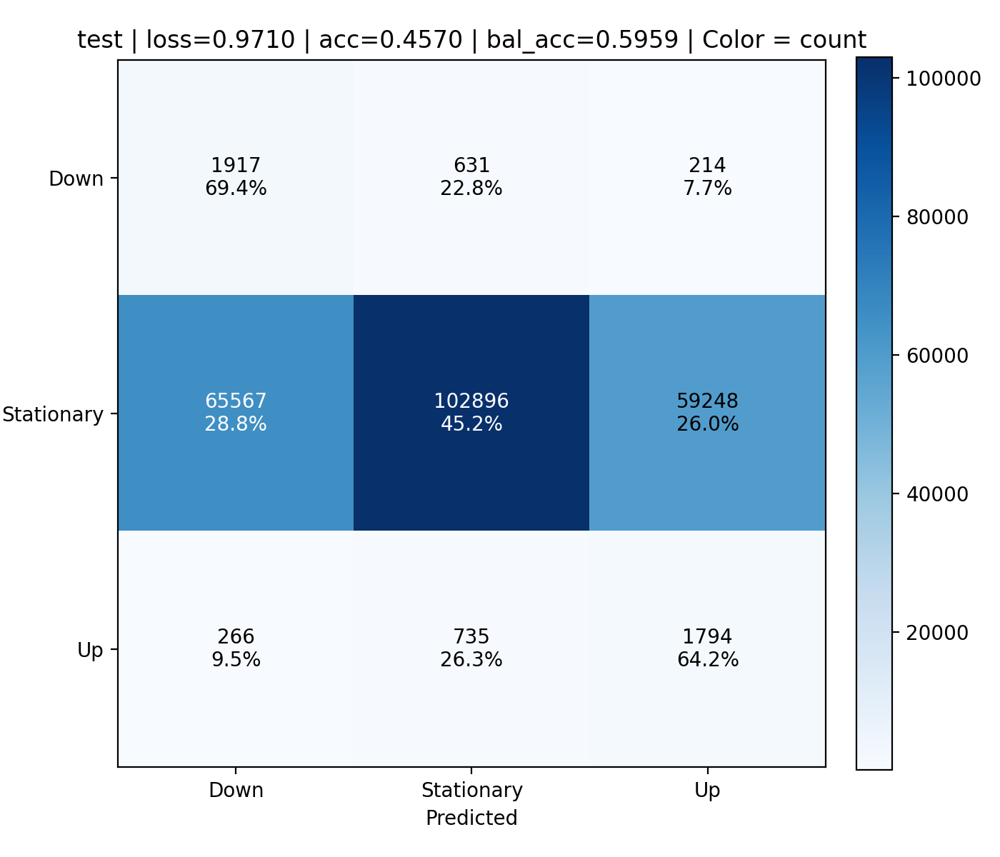
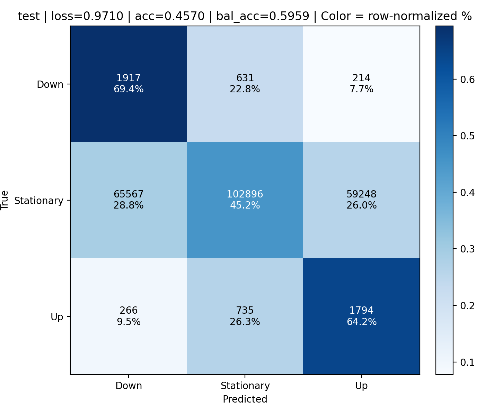
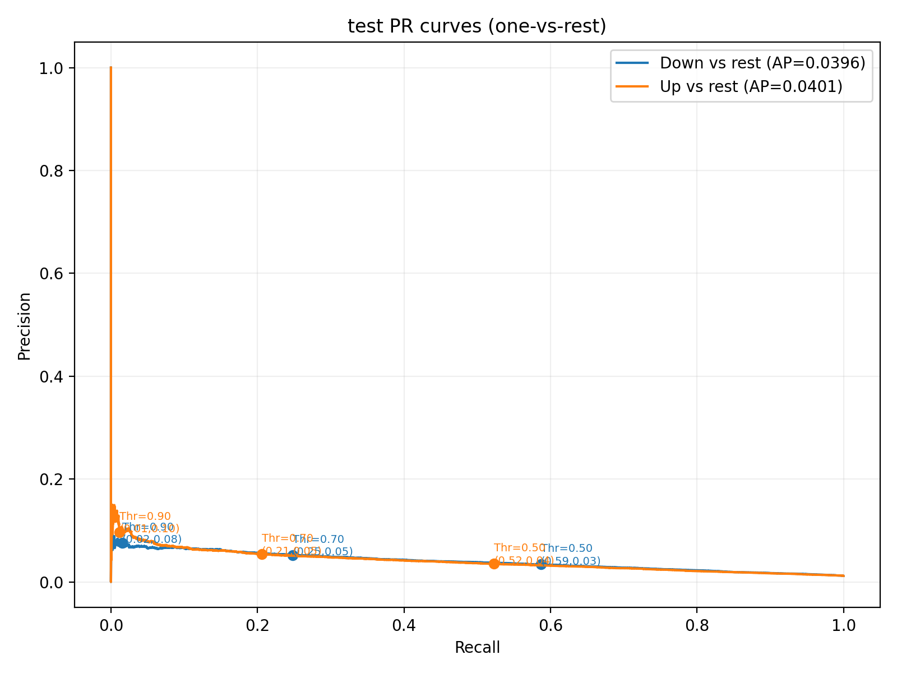
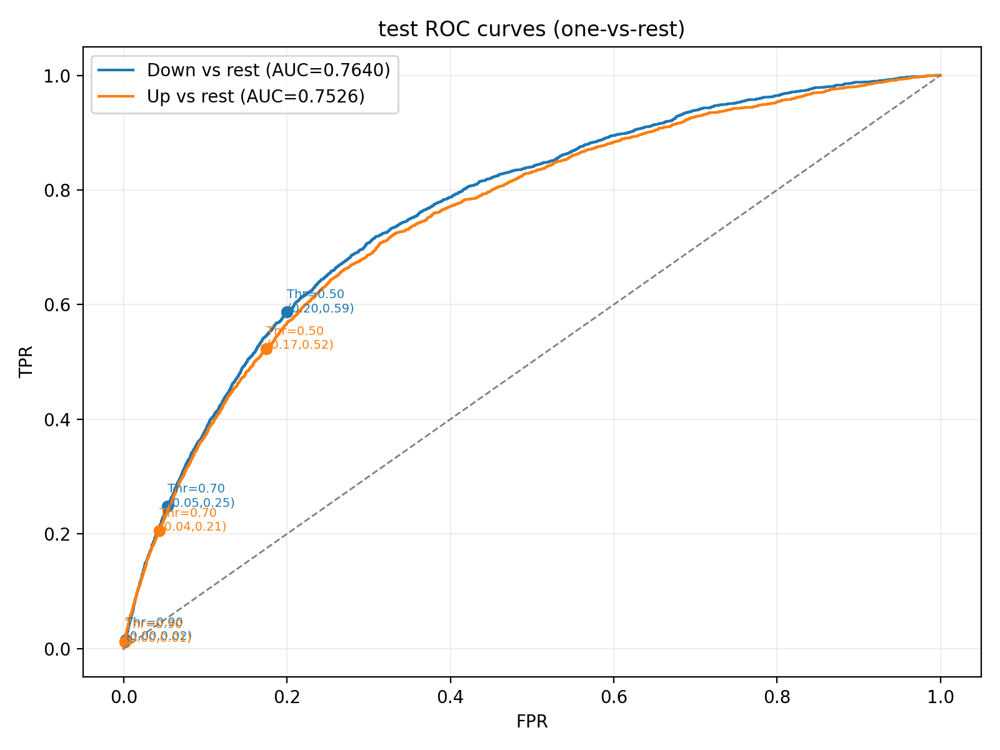
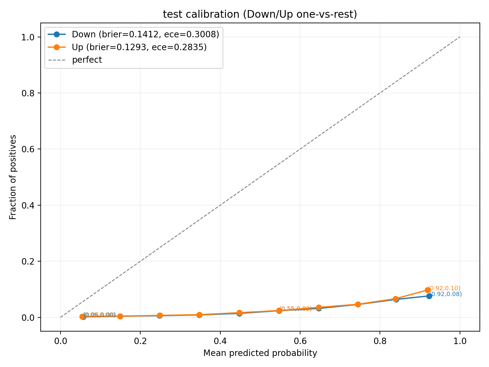
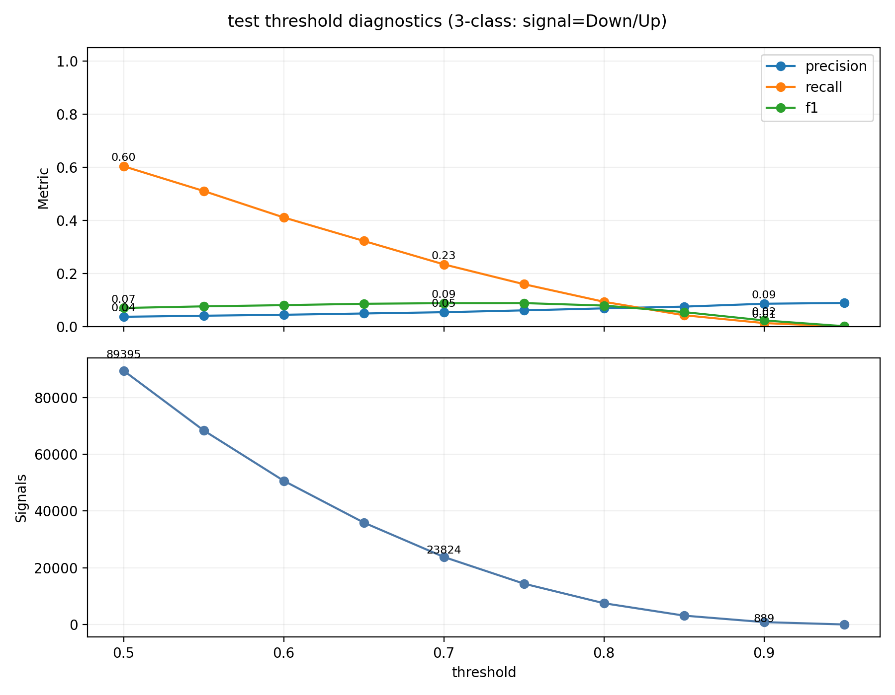

# Model Evaluation Report

**Model Path**: `new_era/15_models_playaround/015_models_playaround_result/lt=smoothed_mid_move_3class__fc=8__w=100__H=5__thr=0p5__expC_snapshot`

## 1. Overall Metrics (Test Split)
- **Macro F1**: 0.2434
- **Balanced Accuracy**: 0.5959
- **Accuracy**: 0.4570

## 2. Classification Report & Averages
| Class | Precision | Recall | F1-Score | Support |
|---|---|---|---|---|
| **Down** | 0.0283 | 0.6941 | 0.0544 | 2762.0 |
| **Stationary** | 0.9869 | 0.4519 | 0.6199 | 227711.0 |
| **Up** | 0.0293 | 0.6419 | 0.0560 | 2795.0 |

| Average Type | Precision | Recall | F1-Score | Support |
|---|---|---|---|---|
| **Macro Avg** | 0.3482 | 0.5959 | 0.2434 | 233268.0 |
| **Weighted Avg** | 0.9641 | 0.4570 | 0.6065 | 233268.0 |

*(Source: `classification_report_test.csv`)*

## 3. Confusion Matrix
### Count

### Percentage

## 4. AUC Metrics & Curves
*(Note: Exact PR-AUC and ROC-AUC numerical values for Up/Down are visualized within the legends of the following plots.)*

### Per-Class Precision-Recall Curve (PR-AUC)

### ROC Curve (ROC-AUC)

## 5. Calibration Curve

## 6. Threshold Diagnostics

**Threshold Diagnostics Data Sample**:
| Threshold | Num Signals | Signal Rate | Precision | Recall | F1 |
|---|---|---|---|---|---|
| 0.50 | 89395 | 0.3832 | 0.0375 | 0.6037 | 0.0707 |
| 0.60 | 50640 | 0.2171 | 0.0451 | 0.4112 | 0.0813 |
| 0.70 | 23824 | 0.1021 | 0.0547 | 0.2347 | 0.0888 |
| 0.80 | 7540  | 0.0323 | 0.0692 | 0.0939 | 0.0797 |
| 0.90 | 889   | 0.0038 | 0.0866 | 0.0139 | 0.0239 |
| 0.95 | 67    | 0.0003 | 0.0896 | 0.0011 | 0.0021 |

*(Full details in `threshold_diagnostics_test.csv`)*
