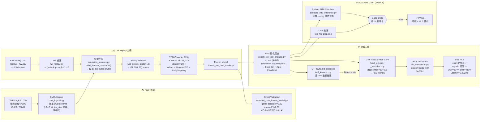

# A1：完整 Pipeline 流程圖

> 適合放在 Slide 2「研究 Pipeline」使用。
> 這個 Mermaid 圖可以直接貼入支援 Mermaid 的工具（如 Obsidian、GitHub、mermaid.live）。

---

## 完整資料與硬體交付流程

---

## 說明口白（可對應投影片講稿）

> 整個系統有三條線並行進行：
>
> **主線（左）**：從 TW replay 事件流，到 TCN 訓練，產出凍結模型。
>
> **次線（上方）**：CME Logic20 資料透過 adapter 接上相同的特徵工程流程，直接用 TW 訓練好的模型驗證——結論是 pipeline 通了，但交易 edge 沒有成立。
>
> **硬體主線（右下）**：凍結模型被量化成 INT8、匯出成 C++ header，再手刻成 HLS-friendly 固定 shape 版本，經過 csim 驗證後送進 Vitis HLS 合成。
>
> **中央的 Gate**：Python 整數模擬器和 C++ 的 `logits_int32` 必須逐 bit 完全相等，這是從 research 走到 hardware delivery 的最後一道驗證防線。

---

## 時間複雜度標注

| 模組 | 估計執行時間 |
|---|---|
| TW replay feature extraction | ~2 min / session |
| TCN training (6 epochs) | ~5 min (CPU) |
| INT8 export | < 30 sec |
| C++ build | < 1 min |
| Vitis HLS csim | ~5 min |
| Vitis HLS csynth | ~15-30 min |
