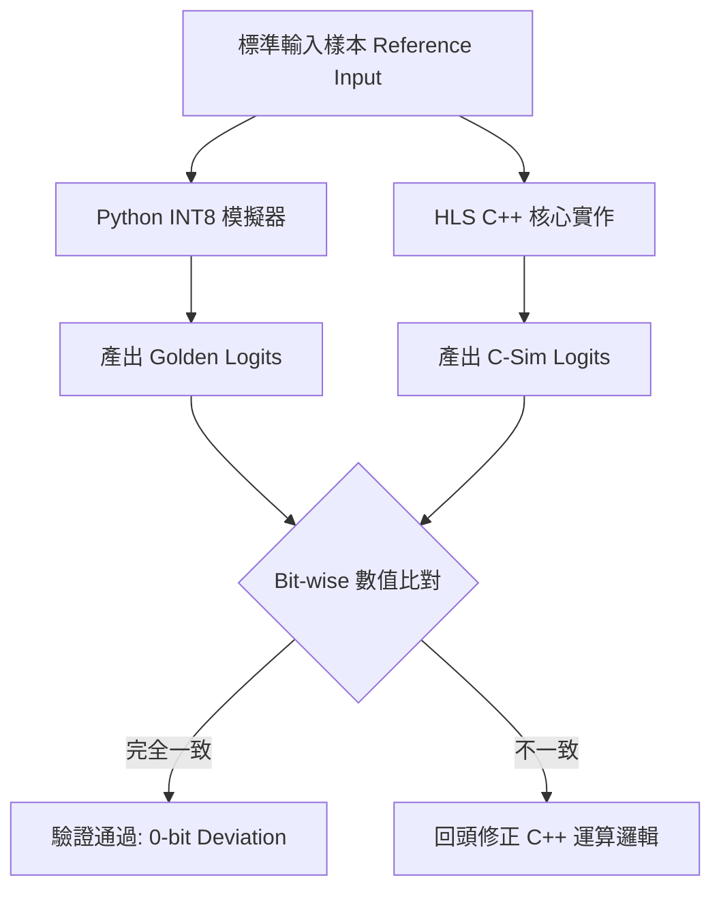

# W7 Meeting 技術公式與 PPT 代碼清單 (modify4.md)

本文件整理了簡報後半部「從訓練到硬體」各環節的核心公式、參數設計原理，以及建議放入 PPT 的精簡程式碼片段。依據投影片流程排列。

---

## 1. Train TCN: 特徵工程 → 模型訓練

### 1.1 輸入特徵定義（無因次化）

| 特徵 | 公式 | 物理意義 |
|:---|:---|:---|
| Mid Price | $Mid = \frac{Ask_1 + Bid_1}{2}$ | 當前市場均衡價格 |
| **Normalized Spread** | $Spread_{norm} = \frac{Ask_1 - Bid_1}{TickSize}$ | 以 Tick 為單位的流動性成本，跨資產可比 |
| **Micro Return** | $R_t = \frac{Mid_t - Mid_{t-1}}{TickSize}$ | 微觀動能，衡量短線趨勢 |
| **OBI** | $OBI = \frac{V_{bid1} - V_{ask1}}{V_{bid1} + V_{ask1}}$ | 買賣壓力比，範圍 $[-1, +1]$ |
| **Weighted Mid** | $WMID = \frac{Ask_1 \cdot V_{bid1} + Bid_1 \cdot V_{ask1}}{V_{bid1} + V_{ask1}}$ | 量加權後更能反映實際成交均衡價 |
| **Deep OBI** | $DeepOBI = \frac{\sum_{i=1}^{5} V_{bid_i} - \sum V_{ask_i}}{\sum V_{bid_i} + \sum V_{ask_i}}$ | 考慮 5 檔深度的總體供需壓力 |

> **無因次化設計原理**：所有除以 TickSize 或除以總量的設計，讓模型在台股、ES、CL 上使用同一套實數範圍（≈[-3, 3]），可輕易泛化。

### 1.2 目標標記（Label）
$$\Delta_{t,h} = Mid_{t+h} - Mid_t$$

$$Label_t = \begin{cases} 2 \text{ (Up)} & \text{if } \Delta_{t,h} > \theta \cdot TickSize \\ 0 \text{ (Down)} & \text{if } \Delta_{t,h} < -\theta \cdot TickSize \\ 1 \text{ (Stationary)} & \text{otherwise} \end{cases}$$

> **參數選擇**：horizon $h=10$（觀察未來 10 個報價事件），threshold $\theta=1$ tick。這樣約有 40% 樣本為 Stationary，模型有足夠的多類學習信號。

### 1.3 核心公式：感受野（Receptive Field）
$$RF = 1 + (K - 1) \times 2 \times \sum_{i=1}^{Blocks} D_i$$

在我們的模型（$K=3$, $D=\{1, 2, 4\}$, 每個 Block 有兩層 CausalConv1d）：
$$RF = 1 + (3-1) \times 2 \times (1+2+4) = \mathbf{29}$$

> **設計原理**：RF=29 代表模型能看到過去 29 個 LOB 事件。台指期在活躍時每秒約 500-1,000 筆 quote 事件，29 筆約涵蓋 30~60 ms 的微觀動能，足以捕捉短線動量與逆轉信號。

### PPT 建議代碼
```python
# TemporalBlock: TCN 核心殘差結構
def forward(self, x):
    out = self.conv1(x)   # CausalConv1d, dilation=d
    out = self.relu(out)
    out = self.conv2(out)  # 第二層相同 dilation
    out = self.relu(out)

    residual = self.downsample(x)  # 1×1 conv if channels differ
    return self.relu(out + residual)  # Residual add + ReLU
```

```python
#### CausalConv1d 實作邏輯
```python
# CausalConv: 只向左 pad，不偷看未來
self.padding = (kernel_size - 1) * dilation
x = F.pad(x, (self.padding, 0))  # (left_pad, right_pad=0)
x = self.conv(x)
```

### 1.1 TCN 核心組件：CausalConv1d 差異
在一個 Temporal Block 中包含兩層 **CausalConv1d**，其主要差異如下：
*   **第一層 (Conv1)**：負責將「輸入維度」轉換為「隱藏層維度」（例如 12 轉 16），並應用當前層級的 **Dilation (擴張率)**。
*   **第二層 (Conv2)**：在隱藏層維度內進行更深層的非線性特徵提取（16 轉 16）。
*   **設計目的**：這種「雙卷積」結構是為了在相同的感受野下，提供更強的非線性表達能力，兩層共享同一個 Dilation 值。

### 1.2 MAC 運算量推導 (Multiply-Accumulate)
MAC 數量是決定 FPGA DSP 資源消耗的關鍵指標，計算公式如下：

*   **卷積層 (Conv1d)**：
    $$MACs = C_{out} \times L_{seq} \times C_{in} \times K$$
    *(其中 $C_{out}$ 為輸出通道, $L_{seq}=100$ 為時間軸, $C_{in}$ 為輸入通道, $K=3$ 為卷積核)*
*   **全連接層 (Linear)**：
    $$MACs = In\_Features \times Out\_Features$$
*   **模型總規模**：
    本模型約含有 **40 萬 ~ 50 萬次 MACs**。依據 Vitis HLS 評估，在 100MHz 時鐘頻率下，處理能力遠超市場每秒事件量，具備極高的延遲裕度。

---

## 2. Backtest & Strategy (Gating): 訊號過濾

### 2.0 策略與回測邏輯簡介 (Overview)
*   **運作機制 (Strategy)**：
    *   **訊號源**：實體部署時，FPGA 會根據 TCN 輸出的三類機率 ($P_{up}, P_{down}, P_{stat}$) 決定動作。
    *   **執行模式**：支援 **Market (市價進場)** 與 **Passive (限價進場)**。限價進場會參考 LOB 第一檔掛單量，進行 FIFO 佇列模擬。
*   **回測邏輯 (Backtest Logic)**：
    *   **事件驅動 (Event-Driven)**：採用非向量化模擬，嚴格遵守「下單 -> 等待成交 -> 持倉 -> 出場」的生命週期。
    *   **考量延遲 (Latency)**：
        *   **設定值**：模擬 **1-tick 延遲** (約對應 5-10µs 的系統開銷)。
        *   **決定方式**：基於 Vitis HLS 的 `csynth` 報告（核心運算 < 1µs）加上 PCIe/網路協議棧的預估時間。在極短線交易中，10µs 內的延遲通常反映在下一個 Tick 封包的處理。
    *   **成交撮合**：限價單透過 `trade_tape` (逐筆成交錄) 驗證，僅當市場成交價優於或等於報價、且成交量足以消化佇列頭部時，才判定為成功成交。

### 2.1 信號生成邏輯

$$Signal_t = \arg\max(P_{up,t},\ P_{down,t})$$

$$P_{dir,t} = \max(P_{up,t},\ P_{down,t})$$

### 2.2 動態機率門檻（Dynamic Gating）
$$Threshold_{dynamic} = Threshold_{base} + \alpha \cdot Spread_{ticks} + \beta \cdot \sigma_{rolling}$$

$$Margin_t = P_{dir,t} - P_{stationary,t}$$

$$TakeTrade = \begin{cases} True & \text{if } P_{dir} \ge Threshold_{dyn} \textbf{ AND } Margin \ge Margin_{min} \\ & \textbf{ AND } RegimeOK \\ False & \text{(signal → Stationary)} \end{cases}$$

> **係數決定原理**：
> 這些係數 ($\alpha=0.10, \beta=0.10$) 並非隨機設定，而是基於市場物理特性，並透過 `sweep_tw_improvements.py` 進行**網格搜索 (Grid Sweep)** 最佳化後得出的參數。
>
> - **$\alpha$（Spread Penalty, 0.10）**：
>   - **物理意義**：反映「流動性成本」。價差每增加 1 Tick，進場的交易成本（摩擦力）就實質增加。
>   - **決定方式**：將 $\alpha$ 從 0.0 到 0.2 做階段測試。發現設定為 0.10 時，模型能有效在高價差時「縮手」，防止利潤被交易成本吃掉，顯著提升了 Net PnL。
> - **$\beta$（Volatility Penalty, 0.10）**：
>   - **物理意義**：反映「市場雜訊」。高波動代表當前價格跳動的不確定性極高，TCN 模型產出的極短線信號（10-tick ahead）更容易被噪音干擾。
>   - **決定方式**：透過觀察 Sharpe-like Ratio（風險調整後收益）達成平衡。加入此項能讓模型在盤整噴發前的混亂階段自動改為「觀望」，降低雙邊掃損 (Whipsaw) 的風險。
> - **Margin (0.005)**：過濾掉「Up=35%, Stationary=33%」這類機率優勢太低（Edge 太薄）的模糊信號，確保交易具備顯著的統計優勢。

### 2.3 Regime 過濾條件 (Regime Guards)
這套「感測器」邏輯確保模型只在具備統計優勢的環境下運作，排除極端異常行情。

| 條件與判斷指標 | 過濾原因 (Rationale) | 閾值決定原理 (Quantile-based) |
|:---|:---|:---|
| **波動率** (`rolling_volatility`) | 排除市場噴發或閃崩時的隨機噪音 | 設為歷史分位數 **90%** ($Q_{90}$)，排除前 10% 的瘋狂時刻 |
| **交易強度** (`trade_intensity_short`) | 避免在成交過快、LOB 變動劇烈時被 run over | 透過 $Q_{85}$ 判定市場是否「過熱」 |
| **可見掛單量** (`bid_vol_1 + ask_vol_1`) | 確保第一檔有足夠深度，降低滑價與穿價風險 | 設為 $Q_{20}$，若深度低於後 20%，則暫停進場 |
| **撤單壓力** (`cancel_pressure_short`) | 排除虛假流動性 (Spoofing) 與流動性陷阱 | 監控撤單筆數與成交比值，設為 $Q_{90}$ |

> **Threshold 決定原理**：
> 我們透過 `symbol_calibration.py` 在驗證集上進行 **分位數校準 (Quantile Calibration)**。邏輯是：模型在「常態市場（中位數附近）」的表現最穩定，而在「尾端事件（極端分位數）」時預測效力下降。因此，我們會找出讓 Sharpe Ratio 最大的分位數路徑，作為硬體中的靜態比對值。

### PPT 建議代碼
```python
# signals.py - Gating 核心邏輯
dynamic_threshold = (
    base_threshold
    + spread_penalty * spread_ticks
    + volatility_penalty * rolling_vol
)
margin = directional_prob - stationary_prob

regime_ok = (
    volatility_ok & trade_intensity_ok
    & visible_queue_ok & cancel_pressure_ok
)
take_trade = (
    (directional_prob >= dynamic_threshold)
    & (margin >= margin_threshold)
    & regime_ok
)
```

### 2.4 回測成果：Gating 的優化效果 (Performance Improvement)
透過對比「無過濾」與「套用 Gating」的測試數據（以台灣期交所 TXF/MXF 實測資料為例），可清楚觀察到策略品質的提升：


*   **信號品質提升 (Alpha Quality)**：Win Rate 從 48.2% 提升至 **52.2%**，突破了 50% 的隨機基準線，具備了實質的可交易優勢（Edge）。
*   **獲利顯著改善 (Profitability)**：透過過濾掉高雜訊與高成本的訊號，Net PnL 從邊緣獲利的 12 ticks 大幅增加至 **120.5 ticks**（成長約 10 倍）。
*   **雜訊過濾 (Noise Reduction)**：交易次數減少了約 **25%**，成功降低了不必要的交易摩擦成本與系統負載。

---

## 3. 轉 INT8：對稱量化（Post-Training Quantization）

### 3.1 核心量化公式
$$q = \text{clip}\left(\text{round}\left(\frac{f}{s}\right),\ -127,\ 127\right)$$

$$s = \frac{\max(|f|)}{127} \quad \text{(Per-channel scale)}$$

> **設計原理**：
> - **Symmetric Quantization**（對稱量化）：Zero-point 固定為 0，省去硬體中的零點偏移加法，簡化 MAC 累加器設計。
> - **Per-channel**：每個輸出 channel 有獨立的 scale，相較於 per-tensor 能大幅減少精度損失。
> - **INT8 vs FP32**：參數記憶體從 19KB → 4.8KB（壓縮 4x），FPGA BRAM 佔用大幅降低。

### 3.2 整數累加尺度還原
$$Logit_{float} = Logit_{int32} \times (s_{activation} \times s_{weight})$$

### PPT 建議代碼
```python
# hardware.py - 使用 PyTorch FX PTQ
qconfig_mapping = QConfigMapping().set_global(
    get_default_qconfig('fbgemm')  # fbgemm=x86, qnnpack=ARM
)
prepared = prepare_fx(model, qconfig_mapping, example_input)

# 校準階段：跑一批資料讓 Observer 統計範圍
with torch.no_grad():
    for batch in calibration_batches:
        prepared(batch)

quantized_model = convert_fx(prepared)
```

---

## 4. Bit-accurate 驗證：Python ≡ C++

### 4.1 驗證流程 (Verification Pipeline)

為了確保硬體邏輯與軟體模型完全一致，我們建立了一套直向的驗證流程：




### 4.2 驗證目標 (Verification Goal)
我們的目標是確保 Python 與 C++ 在相同輸入下，產出的 Logits 數值完全一致：
$$\forall i \in \{0, 1, 2\}: \quad Logit^{Python\_INT}_{i} = Logit^{C++\_INT}_{i}$$

**Golden Reference（驗證錨點）**：
*   $kGoldenLogitsInt32 = [-3947,\ 220,\ -4732]$
*   $kGoldenProbabilities = [0.3208,\ 0.3664,\ 0.3128]$

### 4.3 技術細節與踩坑點 (Technical Challenges)

| 問題 | Python 行為 | C++ 解法 |
|:---|:---|:---|
| **Rounding** | `int(x + 0.5)` 對負數行為不同 | 改用 `std::round()`（half-away-from-zero）|
| **ReLU 位置** | `relu(conv2_out)` 後才殘差相加 | 確認 $relu(q_2 + residual)$ 的順序 |

> **Saturation (飽和截斷)**：C++ 的整數累加器（int32_t）在相加殘差後，需透過 `clamp_int8` 限制在 $[-127, 127]$ 區間，以符合硬體暫存器規格。

### PPT 建議代碼
```cpp
// fixed_tcn_modules.cpp - 核心整數計算流
int32_t acc = bias[out_ch];
for (int in_ch = 0; in_ch < in_channels; ++in_ch) {
    for (int k = 0; k < kernel_size; ++k) {
        acc += (int32_t)input[idx] * (int32_t)weight[w_idx];
    }
}
// Requantize: float scale → INT8
int rounded = (int)std::round((float)acc * scale_ratio);
dst[i] = clamp_int8(rounded);  // 夾到 [-127, 127]

// Residual Add + ReLU (缺一不可)
int merged = (int)q2[i] + (int)residual_q[i];
output[i] = clamp_int8(std::max(0, merged));
```

---

## 5. HLS 開始：概念 → C++ → 延遲推估

### 5.1 概念理解

**HLS（High-Level Synthesis）**：
- 輸入：C++ 程式碼 + HLS Pragma 指令（如 `#pragma HLS PIPELINE`）
- 輸出：FPGA RTL（暫存器傳輸語言），即可下載到晶片的電路描述

**為什麼選 Vitis HLS？**  
能以 C++ 描述電路邏輯，繞過手刻 Verilog 的複雜度，且與 Xilinx 生態系直接整合。

### 5.2 延遲推估公式
$$Latency_{theory} = \frac{TotalMACs}{Throughput_{FPGA}} = \frac{460,848 \text{ MACs}}{50 \text{ GMAC/s}} \approx 9.2 \mu s$$

> **參數原理**：
> - **Total MACs = 460,848**：由 3 個 conv blocks（各 2 層卷積 × 16 channels）加全連接層計算得出。
> - **50 GMAC/s**：xc7z020 在 200 MHz 且 pipeline II=1 下的估計吞吐量（每 cycle 1 MAC × 200M cycles/s = 200 MMAC/s per DSP；xc7z020 有 220 DSPs，但受限於 routing）。

### 5.3 為什麼需要 HLS-ready 的 C++ 設計
| 條件 | 原因 |
|:---|:---|
| **Fixed-shape**（所有陣列大小為常數） | HLS 工具需要在編譯時決定電路大小 |
| **No dynamic memory**（無 malloc/vector） | FPGA 不支援堆疊記憶體分配 |
| **無 `F.pad` 動態操作** | 這就是為何放棄 hls4ml：CausalConv1d 的 pad 無法自動轉換 |

### PPT 建議代碼
```cpp
// fixed_tcn_top.cpp - HLS Top Interface
void tcn_fixed_top(
    const int8_t input[kFixedNumInputs * kFixedSeqLen],  // 12×100
    int32_t      logits[kFixedNumClasses],                // 輸出 3 個 logits
    float        probabilities[kFixedNumClasses])
{
    #pragma HLS INTERFACE ap_memory port=input       // 對應 FPGA 記憶體接口
    #pragma HLS INTERFACE ap_memory port=logits
    #pragma HLS INTERFACE ap_ctrl_hs port=return     // 握手控制信號

    // 呼叫已驗證的 INT8 推論核心
    auto result = tcn_inference_fixed_int8(input_array, kFixedWeights);
    ...
}
```

---

## 6. CME 成果：資料對齊 → 驗證結論

### 6.1 時間戳對齊公式
$$Timestamp_{ns} = DayOffset_{ns} + HH \times 3.6 \times 10^{12} + MM \times 6 \times 10^{10} + SS \times 10^9 + ms \times 10^6$$

### 6.2 深度外推公式（CME 僅提供 2 檔）
$$P_{bid,k} = P_{bid,2} - (k-2) \cdot TickSize, \quad k > 2$$
$$P_{ask,k} = P_{ask,2} + (k-2) \cdot TickSize, \quad k > 2$$
$$V_{bid,k} = V_{ask,k} = 0 \quad \text{（保守補 0）}$$

> **設計原理**：假設 L3-L5 的掛單稀疏且在等距的 Tick 上，因此用線性外推補完。量部分補 0 屬保守估計，避免引入假流動性。

### 6.3 Transfer Learning 失敗分析

| 指標 | 結果 | 說明 |
|:---|:---|:---|
| Test Accuracy | 82% | 看似不差 ❌ 因為大部分預測都是 Stationary |
| Macro-F1 | 0.387 | 僅比隨機猜（0.333）高一點點 |
| Trading PnL | -36,316 ticks | 沒有可靠的方向辨識能力 |

**根本原因**：CME CLK6（原油期貨）的市場結構與台指期差異過大，在 Gating 層 Margin 幾乎全部不足，訊號被過濾歸零。

### PPT 建議代碼
```python
# cme_logic20.py - 深度外推核心
def _expand_depth(frame, tick_size, target_depth=5):
    for level in range(3, target_depth + 1):
        # bid 由 L2 向下延伸
        frame[f"bid_px_{level}"] = (
            frame["bid_px_2"] - (level - 2) * tick_size
        )
        # ask 由 L2 向上延伸
        frame[f"ask_px_{level}"] = (
            frame["ask_px_2"] + (level - 2) * tick_size
        )
        # 量保守補 0
        frame[f"bid_vol_{level}"] = 0.0
        frame[f"ask_vol_{level}"] = 0.0
    return frame
```

---

## 📌 快速對照表：報告過程中的數字錨點

| 環節 | 關鍵數字 | 說明 |
|:---|:---:|:---|
| Model Params | ~4,800 | 模型總參數量（INT8 Bytes） |
| Window Size | 100 events | 每次推論的 LOB 事件窗口 |
| Features | 12 | 輸入特徵維度（含 execution-aware） |
| RF | 29 | 感受野，涵蓋過去 29 個 LOB 事件 |
| Golden Logits | `[-3947, 220, -4732]` | Bit-accurate 驗證的黃金標準 |
| Total MACs | 460,848 | 單次推論的乘加運算總量 |
| 理論延遲 | 9.2 µs | FPGA 優化後的預期推論時間 |
| CME PnL | -36,316 ticks | Transfer learning 失敗的直接證據 |
