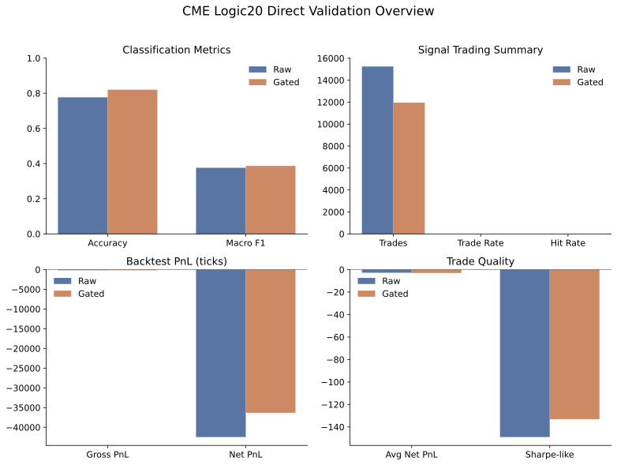
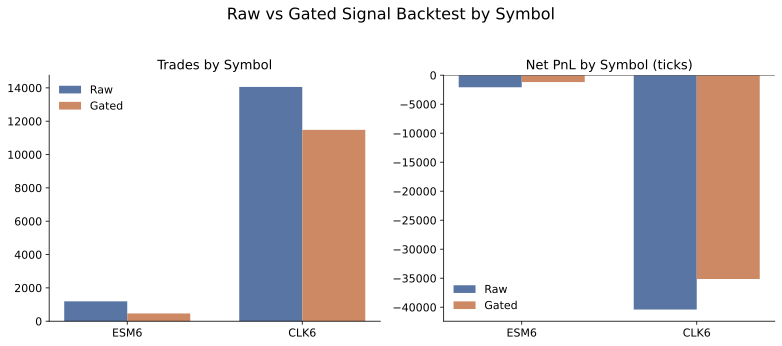
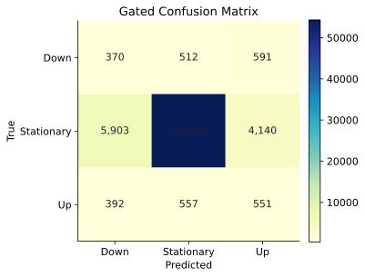
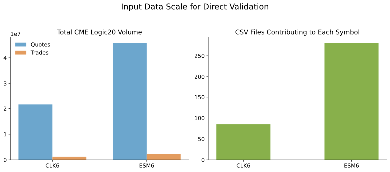
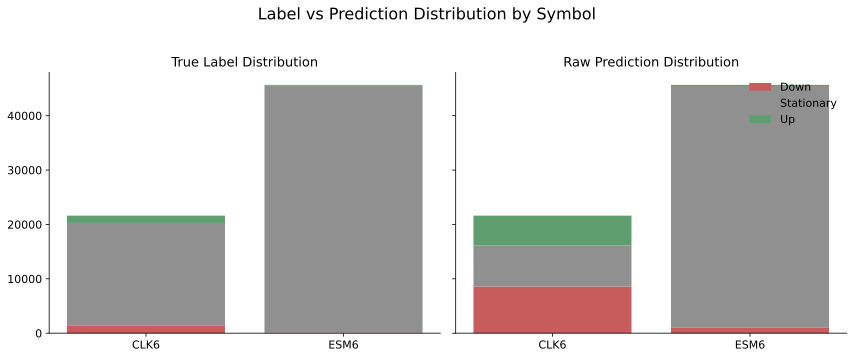

# CME Logic20 直接驗證結果整理

## 1. 這份資料夾是做什麼的
這個資料夾整理的是 `Week 6` 的 `CME Logic20 direct validation` 結果，目的有三個：

1. 把目前 `CME` 驗證的核心結果整理成圖表，方便放進投影片。
2. 把資料處理流程用一張清楚的流程圖講明白。
3. 把主要程式碼的角色解釋清楚，避免報告時只剩下檔名而不知道它們各自負責什麼。

這一批圖表與說明都來自下列來源：
- 驗證結果主目錄：`artifacts/02_model_runs/cme_eval_transfer/20260407_161938`
- 主要摘要：`summary.json`
- by-symbol 結果：`signal_backtest_raw_by_symbol.csv`、`signal_backtest_gated_by_symbol.csv`
- 輸入資料摘要：`cme_file_summary.csv`

---

## 2. 核心結論

### 2.1 一句話版本
`CME Logic20` 的 adapter 與驗證 pipeline 已經打通，但目前 `TW replay` 訓練出的 frozen TCN 雖然在分類上可以跑出不差的 accuracy，交易上仍然是負 edge。

### 2.2 主要數字
- Symbols：`ESM6`, `CLK6`
- Feature set：`execution_aware`
- Window：`100 events`
- Horizon：`10 events`
- Threshold：`1.0 tick`
- Sample stride：`1000`
- Gated Accuracy：`0.8202`
- Gated Macro F1：`0.3868`
- Gated Signal Net PnL：`-36,316.5 ticks`

### 2.3 解讀
這組結果代表：
- `CME Logic20 -> adapter -> feature -> TCN -> backtest` 整條線是通的
- 但目前 `TW trained model` 不能直接通用到 `CME`
- 問題不是資料接不上，而是跨市場 directional edge 沒有成立

---

## 3. 圖表總覽

### 3.1 整體驗證概覽


重點怎麼看：
- 左上：`accuracy` 與 `macro_f1`，gating 後都有小幅改善
- 右上：gating 後 trade 數下降，代表系統變保守
- 左下：即使 gating 後，`net pnl` 仍然明顯為負
- 右下：平均每筆交易品質仍然不好，`sharpe-like` 也為負

結論：

> gating 有幫助，但還不足以把這顆 transfer model 變成可交易策略。

---

### 3.2 各商品的 raw vs gated 對比


重點怎麼看：
- `ESM6` 的 gating 後 trade 數從 `1192` 降到 `466`
- `ESM6` 的 net pnl 從 `-2079.0` 改善到 `-1181.5`
- `CLK6` 的 gating 後 trade 數也下降，但 net pnl 仍然非常差：`-35135.0`

結論：

> 現在 `ESM6` 比較接近可救，`CLK6` 目前明顯更難直接沿用 `TW` 模型。

---

### 3.3 Gated confusion matrix


重點怎麼看：
- 中間的 `Stationary` 仍然佔絕大多數
- `Down` 與 `Up` 類別的辨識仍然偏弱
- 這也解釋了為什麼 accuracy 不差，但交易結果不好

結論：

> 模型大多數時間是在判斷「不要動」，而不是成功抓出可交易的短期方向。

---

### 3.4 輸入資料規模


重點怎麼看：
- `CLK6` 的 quote / trade 數量都比 `ESM6` 大得多
- 現在不是資料量不夠，而是商品本身行為差異很大

結論：

> 這支持了下一步改做 `symbol-specific model` 的決策。

---

### 3.5 True label vs raw prediction distribution


重點怎麼看：
- `ESM6` 的真實 label 幾乎全是 `Stationary`
- `CLK6` 雖然也以 `Stationary` 為主，但模型會產生明顯更多 directional prediction
- 這代表模型在 `CLK6` 上更常出手，但沒有把這些出手轉成正向 PnL

結論：

> 問題不是模型完全不出方向，而是方向判斷品質與交易品質都不夠高。

---

## 4. 資料處理流程圖

```mermaid
flowchart LR
    A["CME Logic20 CSV<br/>雙商品逐行快照"] --> B["discover_logic20_files()<br/>找到可讀的 CSV 檔"]
    B --> C["parse_logic20_header()<br/>辨識產品欄位與 suffix"]
    C --> D["_build_symbol_frames()<br/>雙商品拆成單商品"]
    D --> E["標準化成 LOB schema<br/>bid_px_i / ask_px_i / bid_vol_i / ask_vol_i"]
    E --> F["若只有前 2 檔<br/>向外補到 5 檔"]
    F --> G["trade_price / trade_volume<br/>抽出成交紀錄"]
    G --> H["build_tw_feature_frame()<br/>算 12 維 execution-aware features"]
    H --> I["WindowedLOBSequenceDataset<br/>100-event window"]
    I --> J["Frozen TW TCN inference"]
    J --> K["classification metrics"]
    J --> L["probability gating"]
    L --> M["signal backtest"]
    K --> N["summary / csv / charts"]
    M --> N
```



---

## 5. 程式碼解說

### 5.1 `src/data/cme_logic20.py`
這個檔案的角色是：

> 把供應商格式的 `CME Logic20` 快照，轉成專案既有的標準 LOB schema

主要做的事情：
- `discover_logic20_files()`
  - 找出 `Logic20_SetProduct` 下面所有可讀 CSV
- `parse_logic20_header()`
  - 解析欄位 suffix，例如 `BQ0`, `BP0`, `AQ0`, `LP`, `LQ`
- `_build_symbol_frames()`
  - 把一個雙商品 CSV 拆成單商品的 quote frame 與 trade frame
- `_expand_depth()`
  - 目前只有前兩檔時，保守補到 5 檔
- `load_cme_logic20_bundle()`
  - 把所有檔案整理成：
    - `lob_frames`
    - `trade_frames`
    - `tick_sizes`
    - `summary`

這個檔案的價值在於：

> 它讓 `CME` 可以共用原本已經寫好的 feature pipeline，而不需要重寫整條資料線。

---

### 5.2 `scripts/02_train_eval/evaluate_cme_frozen_model.py`
這支腳本的角色是：

> 不重訓，直接把 `TW replay` 上凍結好的 TCN 丟到 `CME` 上驗證

主要步驟：
1. 讀 `CME Logic20 bundle`
2. 用 `build_tw_feature_frame()` 建立與台股主線相同的 feature
3. 建 `WindowedLOBSequenceDataset`
4. 載入 frozen `best_model.pt`
5. 產出：
   - `raw metrics`
   - `gated metrics`
   - `signal backtest`
   - `by-symbol summary`

這支腳本的重要性在於：

> 它回答的是「跨市場直接搬用」這個問題，而不是「重訓後能不能更好」。

---

### 5.3 `scripts/02_train_eval/train_tw_baseline.py` 裡的 `build_tw_feature_frame()`
雖然名稱叫 `tw`，但目前它已經是：

> 主要的通用 feature builder

它會在 quote / trade 對齊後，算出：
- 基本無因次特徵
- `weighted_mid_deviation`
- `rolling_volatility`
- `near_depth_obi`
- `book_slope_imbalance`
- `queue_imbalance`
- 各種 trade / cancel flow 特徵

這也是為什麼 `CME` 現在能快速接到現有模型：
- 因為 `adapter` 只要把資料轉成標準欄位
- 後面的 feature builder 就可以直接重用

---

### 5.4 `src/features/execution_features.py`
這個檔案的角色是：

> 把成交流與撤單壓力，對齊到 quote event 上

主要做的事情：
- `infer_trade_signs()`
  - 估計 trade 是主動買還是主動賣
- `align_trade_features_to_quotes()`
  - 把多筆成交對齊到最近的 quote event
  - 算出：
    - `aggressor_imbalance_interval`
    - `rolling_signed_flow_ratio`
    - `trade_intensity_short`
    - `bid_cancel_proxy`
    - `ask_cancel_proxy`
    - `net_cancel_pressure`
    - `cancel_pressure_short`

這個檔案很重要，因為它解決了：

> trade event 不直接當模型時間軸，但仍然要把 trade flow 的資訊帶進模型

---

### 5.5 `src/training/datasets.py`
這個檔案的角色是：

> 把 event-level feature frame 轉成模型真正吃的 windowed dataset

`WindowedLOBSequenceDataset` 會：
- 保存整張 feature matrix
- 每次只在 `__getitem__` 時切出一個 `(100, 12)` 視窗
- 對應出：
  - `x`
  - `y`
  - `future_return_ticks`
  - `spread_ticks`
  - `timestamp`
  - `symbol`

這種 lazy dataset 的好處是：
- 不必一次 materialize 全部 3D tensor
- 對高頻事件資料更省記憶體

---

### 5.6 `src/training/trainer.py`
這個檔案的角色是：

> 負責純模型訓練與 prediction 匯出

這裡面重要的點有：
- `weighted CrossEntropyLoss`
- `Adam`
- `early stopping`
- `predict_model()`

`predict_model()` 之所以重要，是因為它不只輸出：
- `prob_down`
- `prob_stationary`
- `prob_up`

還會一起保留：
- `future_return_ticks`
- `spread_ticks`
- `rolling_volatility`
- `queue_imbalance`
- `trade_intensity_short`
- `cancel_pressure_short`

這讓後面的 gating 與 backtest 可以直接接上。

---

### 5.7 `src/backtest/signals.py`
這個檔案的角色是：

> 把 raw class probability 轉成真正的交易訊號

`apply_probability_gating()` 的想法是：
- 若 directional probability 不夠高，就不交易
- 若與 `Stationary` 的 margin 不夠大，也不交易
- 也可以疊加：
  - volatility guard
  - trade intensity guard
  - visible queue guard
  - cancel pressure guard

這一步對 CME 驗證特別重要，因為：

> 我們要區分「模型本身的 raw output」和「加上交易門檻後的可交易 output」

---

## 6. 報告時可以怎麼講這一段
你可以直接這樣說：

> 這週我完成了 CME Logic20 的直接驗證。資料先經過 adapter 從供應商格式轉成標準 LOB schema，再共用台股主線的 execution-aware feature pipeline，形成 100-event 的輸入視窗，最後把台股上訓練好的 frozen TCN 直接丟到 CME 上驗證。結果顯示 pipeline 是通的，但 trading edge 沒有成立，尤其 CLK6 的 net PnL 明顯很差。這代表現在的問題不是資料接不上，而是共享模型跨市場泛化不足，因此下一步要改成 ES、CL、NQ 各自訓練模型，而不是再硬撐共享 transfer。 

---

## 7. 檔案清單
- `p01_cme_validation_overview.svg`
- `p02_cme_validation_by_symbol.svg`
- `p03_cme_gated_confusion_matrix.svg`
- `p04_cme_input_data_scale.svg`
- `p05_cme_label_prediction_distribution.svg`
- `chart_manifest.json`
- `cme_logic20_validation_report.md`

---

## 8. 這批內容怎麼重跑
若之後想用新的 `CME` 驗證結果重新生成圖表，可執行：

```powershell
python scripts\06_reporting\generate_cme_w6_result_assets.py
```

目前這支腳本預設讀的是：

```text
artifacts/02_model_runs/cme_eval_transfer/20260407_161938
```

如果未來你要改成新的 run，建議直接修改腳本內的 `SOURCE_DIR`。
