# Week 14 HFT FPGA Advisor Digest

Source `Week14_HFT_FPGA_Advisor_Digest.md` was not found in the workspace, so this v2 digest was rebuilt from the current audited artifacts.

---

# Week 14 Advisor Digest v2 Addendum

This addendum is presentation-ready but deliberately conservative.

Hard boundaries:

- Do not claim real-world profitability.
- Do not claim FPGA improves PnL.
- Do not claim true queue replay.
- Do not claim the controller beats exact-matched random quote selection; that test is saturated.

## Figure Index

### Baseline Mechanics

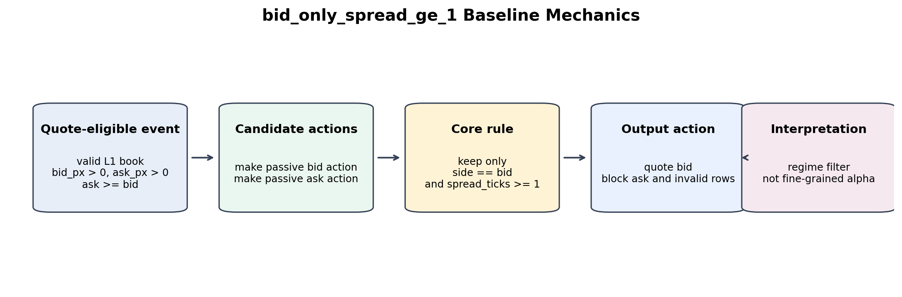

### Quote Bid/Ask Mechanics

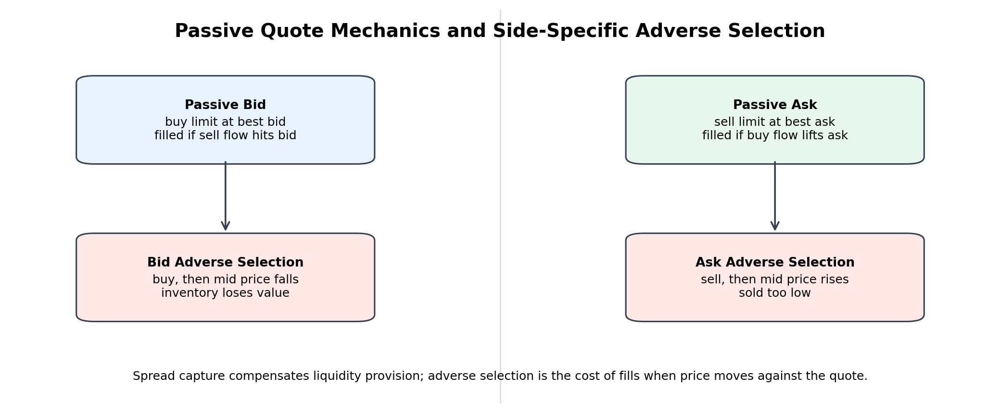

### L1 vs L2 Book Usage

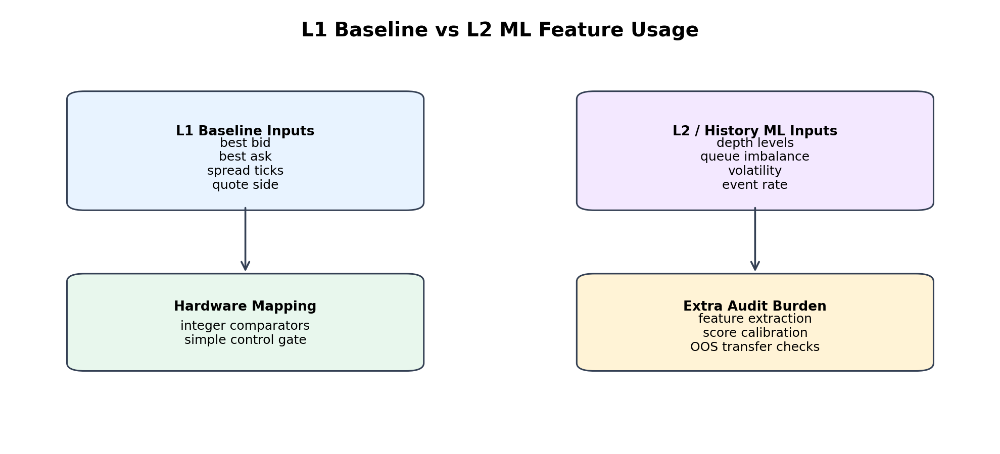

### ML Filtering Waterfall

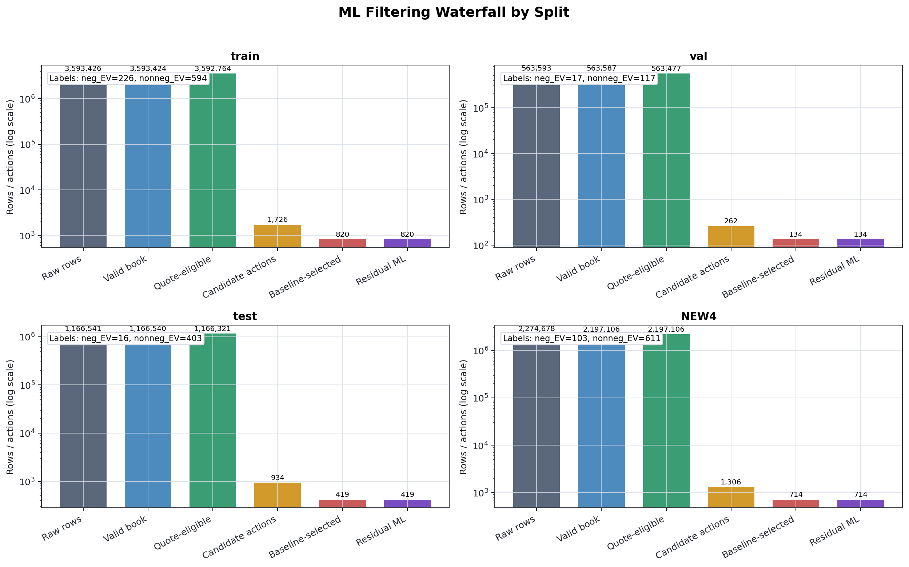

### Spread Distribution

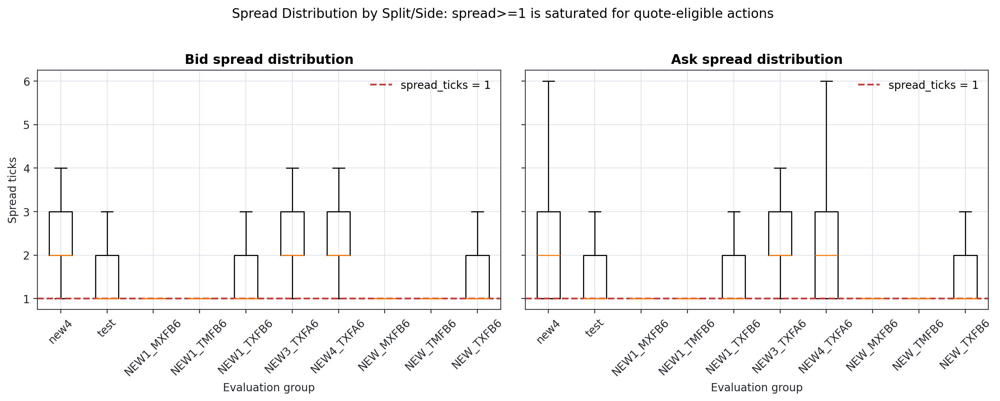

### Rule Ablation

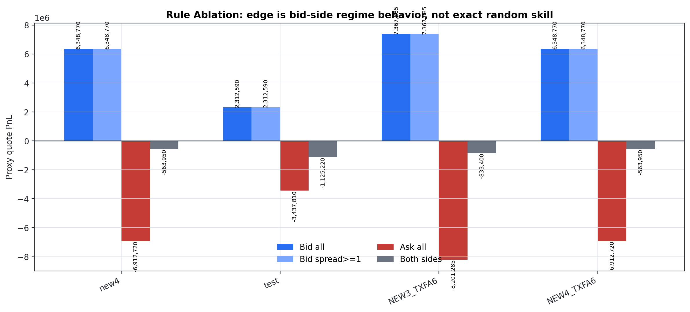

### ML vs Baseline

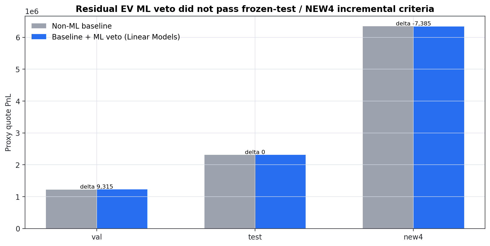

### ML Classification Metrics

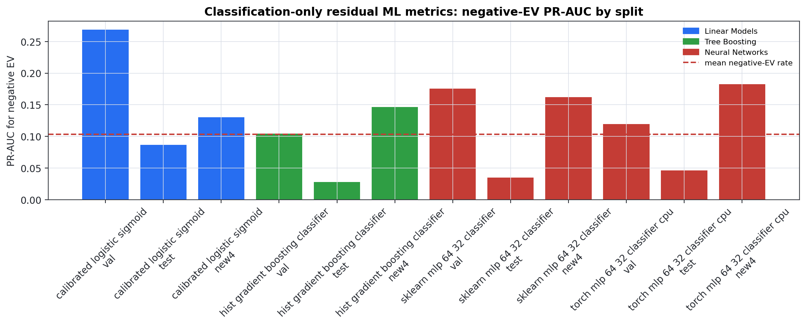

### ML Validation Threshold Curves

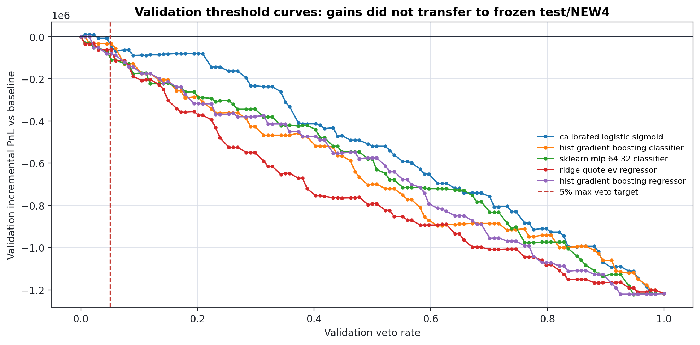

### ML Epoch Loss Curves

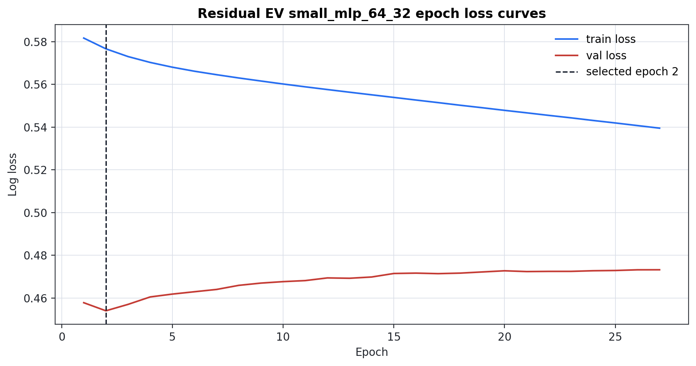

### ML Epoch Metric Curves

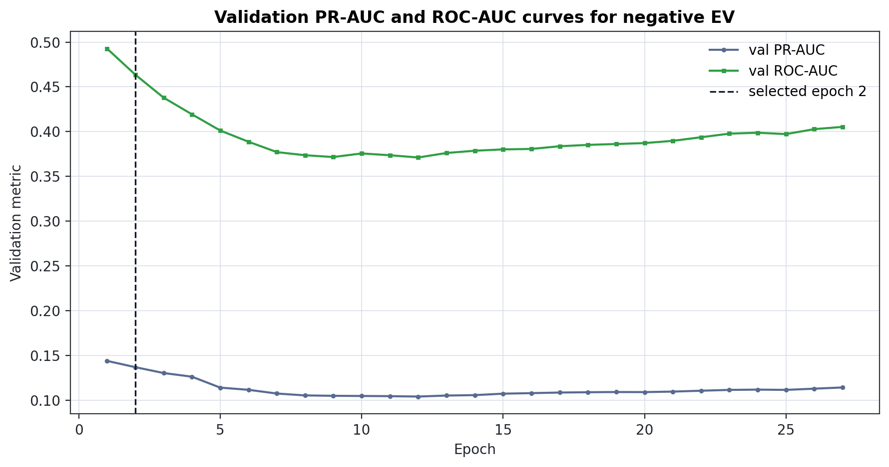

### ML Overfit Diagnostic

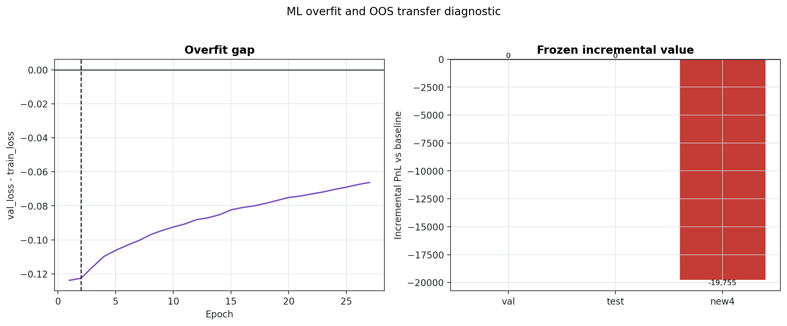

### ML Confusion Matrices

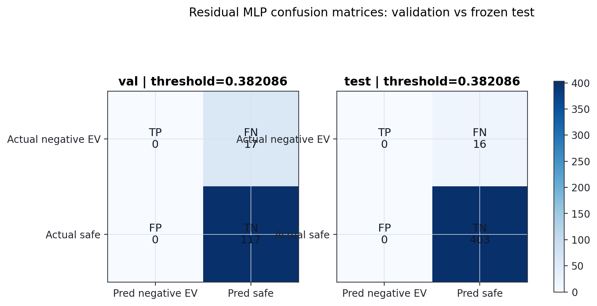

### ML Future Work Decision Tree

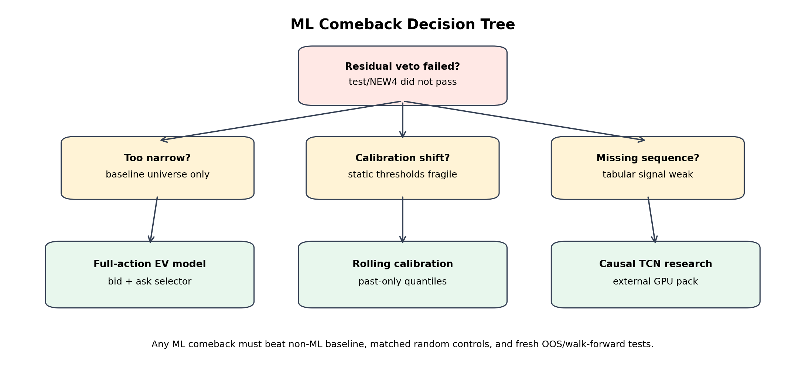

### Queue Stress Heatmap

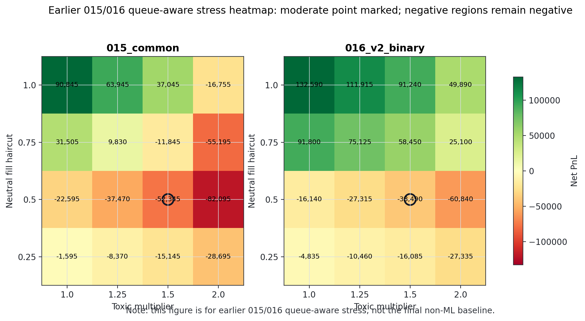

### LOSO Robustness

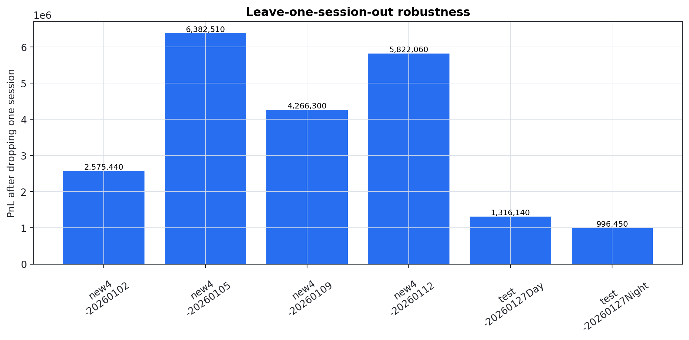

### LOSO Session Concentration

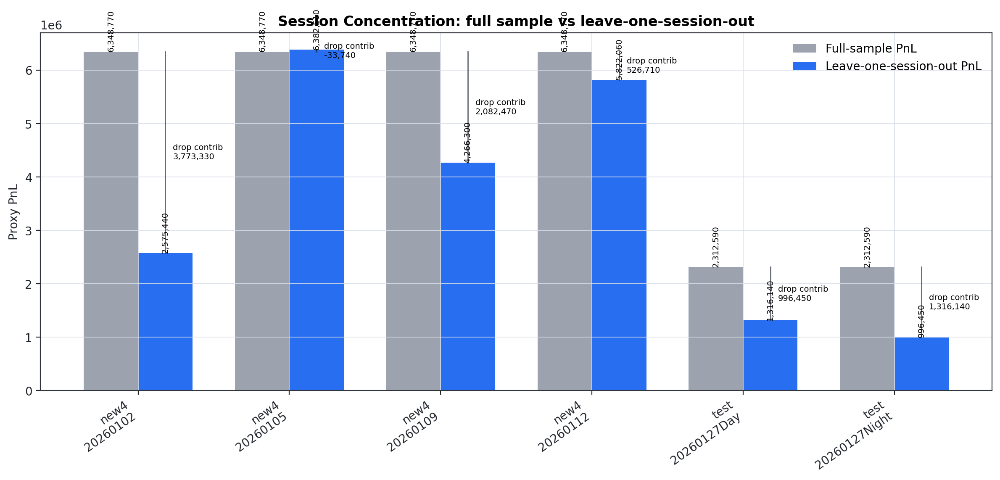

### Adverse Stress Grid

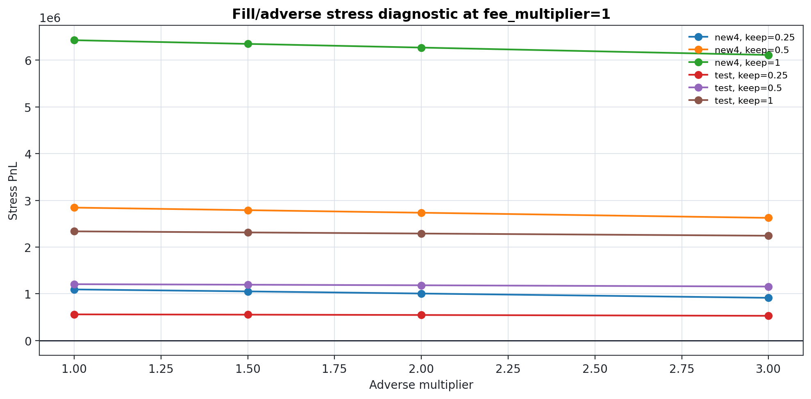

### Oracle Gap

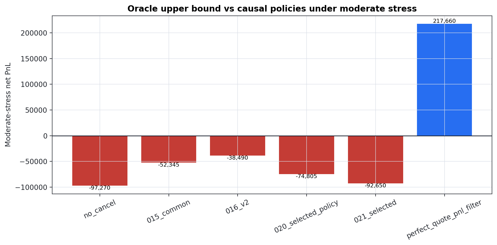

### Simulation Environment Table

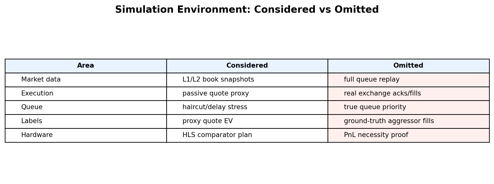

### Latency Path Diagram

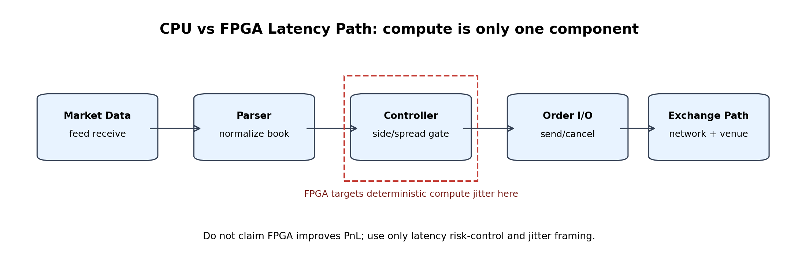

## Explanatory Modules

# Baseline Method Explanation

The final non-ML controller is `bid_only_spread_ge_1`.

Decision logic:

- Start from quote-eligible rows with a valid L1 book: positive best bid, positive best ask, and non-negative spread.
- Construct two passive candidate actions per event: one bid quote and one ask quote.
- Keep a candidate only when `side == bid` and `spread_ticks >= 1`.
- The rule does not read future returns, quote EV, toxicity labels, oracle labels, or model scores.

Important interpretation:

- In the current quote-eligible universe, all candidate spreads are at least one tick, so `spread_ticks >= 1` is saturated.
- The controller is therefore best described as a simple bid-side regime filter, not a fine-grained alpha model.
- The evidence is simulator-derived proxy robustness, not proof of real-world profitability.

Figure: `figures/baseline_flowchart.png`.

---

# Quote Bid/Ask Mechanics

A passive market maker posts limit orders instead of crossing the spread.

- Passive bid: place a buy limit order at or near the best bid. If filled, the strategy buys inventory.
- Passive ask: place a sell limit order at or near the best ask. If filled, the strategy sells inventory.
- Spread capture is the intended compensation for providing liquidity.
- Adverse selection is the risk that the quote is filled because informed flow is moving against it.

Side-specific adverse examples:

- Bid adverse selection: the quote buys, then the mid price falls. The position is immediately underwater.
- Ask adverse selection: the quote sells, then the mid price rises. The strategy has sold too low.

The project uses proxy quote EV and stress-adjusted fill assumptions because true exchange fills and queue position are not available.

Figure: `figures/quote_bid_ask_diagram.png`.

---

# L1 vs L2 Data Usage

The deployed baseline uses only L1-level information:

- best bid price
- best ask price
- spread in ticks
- quote side

The rejected ML extensions used richer causal features derived from L2 or event history, such as queue imbalance, depth ratios, volatility, and event rate. Those features may still be useful for future research, but they did not pass the incremental value criteria in the residual-veto setting.

This distinction matters for hardware design: the baseline maps to simple comparators, while ML/L2 policies require feature extraction, score calibration, and additional audit burden.

Figure: `figures/l1_l2_book_diagram.png`.

---

# ML Filtering Waterfall

This table traces the data flow used by the residual Quote-EV ML veto diagnostics.
Counts are split-specific and are read from frozen artifacts; no model is retrained here.

Pipeline meaning:

- `raw_rows`: selected-symbol input rows before the local filter stage.
- `valid_book_rows`: rows with valid top-of-book/depth after the book-validity filter.
- `quote_eligible_rows`: rows admitted into the quote/action source universe. For NEW4, this equals the external OOS valid-book action source because NEW4 was not used for training or validation selection.
- `candidate_actions`: passive bid/ask candidate fills generated by the fill-proxy action table.
- `baseline_selected_actions`: candidate actions selected by `bid_only_spread_ge_1`.
- `residual_ml_samples`: the residual EV-veto dataset restricted to the baseline-selected universe.
- `negative_ev_labels` / `nonnegative_ev_labels`: final residual label counts using `quote_ev_moderate < 0`.


## Counts

| split   |   raw_rows |   valid_book_rows |   quote_eligible_rows |   candidate_actions |   baseline_selected_actions |   residual_ml_samples |   negative_ev_labels |   nonnegative_ev_labels |   negative_ev_rate | source_note                                                                                                                            |   baseline_to_candidate_rate |   residual_to_baseline_rate |
|:--------|-----------:|------------------:|----------------------:|--------------------:|----------------------------:|----------------------:|---------------------:|------------------------:|-------------------:|:---------------------------------------------------------------------------------------------------------------------------------------|-----------------------------:|----------------------------:|
| train   |    3593426 |           3593424 |               3592764 |                1726 |                         820 |                   820 |                  226 |                     594 |          0.27561   | Historical split from 016 quote-eligible universe, then Phase 031 full-action table.                                                   |                     0.475087 |                           1 |
| val     |     563593 |            563587 |                563477 |                 262 |                         134 |                   134 |                   17 |                     117 |          0.126866  | Historical split from 016 quote-eligible universe, then Phase 031 full-action table.                                                   |                     0.51145  |                           1 |
| test    |    1166541 |           1166540 |               1166321 |                 934 |                         419 |                   419 |                   16 |                     403 |          0.0381862 | Historical split from 016 quote-eligible universe, then Phase 031 full-action table.                                                   |                     0.448608 |                           1 |
| NEW4    |    2274678 |           2197106 |               2197106 |                1306 |                         714 |                   714 |                  103 |                     611 |          0.144258  | External OOS NEW4 used the valid-book controller/action-source flow; no train/val quote-eligible refit or boundary tuning was applied. |                     0.546708 |                           1 |

## Source Artifacts

- Historical raw/valid/quote-eligible counts: `C:\Users\holbo\00VS_projjects\00_HFT_project\new_era\16_binary_label_v2\results\filter_waterfall_by_split.csv`.
- Full candidate action universe: `C:\Users\holbo\00VS_projjects\00_HFT_project\new_era\31_opportunity_cost_audit\data\full_action_universe.parquet`.
- Residual baseline universe labels: `C:\Users\holbo\00VS_projjects\00_HFT_project\new_era\28_residual_quote_ev_veto\data\baseline_universe_quote_ev.parquet` and `C:\Users\holbo\00VS_projjects\00_HFT_project\new_era\28_residual_quote_ev_veto\data\new4_baseline_universe_quote_ev.parquet`.
- NEW4 exact selected-symbol raw/valid scan: `C:\Users\holbo\00VS_projjects\00_HFT_project\new_era\34_report_expansion_figures_and_methods\results\new4_raw_valid_book_counts.csv`.

---

# Table Column Definitions and Blank Cell Policy

This project intentionally distinguishes missingness from zero-valued metrics.
A blank cell or `NaN` should never be read as a hidden zero.

| Cell representation | Meaning | Typical reason | Interpretation rule |
| --- | --- | --- | --- |
| Empty string / blank cell | Not computed in that artifact | Metric did not belong to the table or the upstream script did not produce it | Do not compare numerically; inspect the table note/source artifact |
| `NaN` | Computation was attempted but undefined | No samples in a subgroup, one-class label vector, or division by zero denominator | Treat as undefined, not as pass/fail by itself |
| `NA` / `not_applicable` | Metric is structurally not applicable | Example: regression metric for a pure classification-only plot | Exclude from aggregate comparisons |
| `source_missing` | Required upstream source artifact or source column was absent | Placeholder reports or compatibility audits | The claim is unsupported until the source is regenerated |
| `0` or `0.0` | Computed numeric zero | Count, PnL, loss, or rate genuinely evaluated to zero | It is a real value and can be compared numerically |

For final advisor-facing tables, any ambiguous blank from older phases should be read alongside the nearest `status`, `note`, `source_note`, or report paragraph.
New Phase 034 follow-up tables use explicit note/status columns where a source was not available or a metric is not applicable.

---

# Exact Matched Random Explanation

The Phase 032 exact matched random quote baseline produced p-value `1.0` and zero variance. That is not evidence against or for the controller; it is a saturation diagnostic.

Why it saturates:

- The controller selects `side == bid` and `spread_ticks >= 1`.
- In the quote-eligible action universe, every bid action has `spread_ticks >= 1`.
- Therefore the policy selects the entire exact candidate universe.
- A random selector constrained to the same exact universe and the same session/spread-bucket counts has no alternative quotes left to sample.

Correct wording: the exact matched random test is non-informative for quote-selection skill.

Forbidden wording: the baseline beat exact matched random quote selection.

---

# ML Model Results Explanation

The ML workstreams tested whether residual ML could improve the conservative baseline by vetoing bad quotes inside the `bid_only_spread_ge_1` universe.

Inputs and safeguards:

- Training used causal tabular features such as spread, queue imbalance, depth, volatility, event rate, and imbalance changes.
- Thresholds were selected on validation only.
- Frozen test and NEW4 were not used for model selection.
- ML had to beat matched random veto 95p and improve baseline PnL at low veto rates.

Observed outcome:

- Validation sometimes showed small improvements.
- Frozen test produced zero useful vetoes or no improvement.
- NEW4 did not survive the matched-random veto hurdle.

Conservative interpretation: residual ML did not pass the incremental-value standard. This does not prove all ML is useless; it says this residual veto framing was too narrow or unstable.

Phase 034 recovered this gap by running `small_mlp_64_32_epoch_rerun` on the same residual universe with validation-only early stopping. The real epoch curves are now included as `figures/ml_epoch_loss_curves.png`, `figures/ml_epoch_metric_curves.png`, and `figures/ml_overfit_diagnostic.png`.

The recovered curves improve transparency but do not revive ML: the frozen rerun still failed to improve both test and NEW4 over the non-ML baseline.

---

# ML Feature Metadata

All residual ML families in Phase 28/30 used the same causal residual EV tabular feature set unless noted otherwise.

## Shared Tabular Feature Set

- `spread_ticks`
- `queue_imbalance_calc`
- `deep_imbalance_calc`
- `top_depth`
- `depth_ratio`
- `volatility_past_50`
- `abs_return_past_50`
- `event_rate_past_50`
- `queue_imbalance_change_past`
- `normalized_spread_calc`

## Feature Categories

- L2 depth features: `queue_imbalance_calc`, `deep_imbalance_calc`, `top_depth`, `depth_ratio`.
- Imbalance ratios: `queue_imbalance_calc`, `deep_imbalance_calc`, `depth_ratio`.
- Rolling/lagged features: `volatility_past_50`, `abs_return_past_50`, `event_rate_past_50`, `queue_imbalance_change_past`.
- Spread features: `spread_ticks`, `normalized_spread_calc`.

## Model Family Feature Table

| Model family | Color | Input format | Uses L2 depth | Uses imbalance ratios | Uses rolling/lagged features | Sequence window | Feature columns |
| --- | --- | --- | --- | --- | --- | --- | --- |
| Linear Models (Logistic) | `#276ef1` | Tabular | Yes | Yes | Yes | None | `spread_ticks`, `queue_imbalance_calc`, `deep_imbalance_calc`, `top_depth`, `depth_ratio`, `volatility_past_50`, `abs_return_past_50`, `event_rate_past_50`, `queue_imbalance_change_past`, `normalized_spread_calc` |
| Tree Boosting (HGB) | `#2f9e44` | Tabular | Yes | Yes | Yes | None | `spread_ticks`, `queue_imbalance_calc`, `deep_imbalance_calc`, `top_depth`, `depth_ratio`, `volatility_past_50`, `abs_return_past_50`, `event_rate_past_50`, `queue_imbalance_change_past`, `normalized_spread_calc` |
| Neural Networks (MLP) | `#c43c35` | Tabular | Yes | Yes | Yes | None | `spread_ticks`, `queue_imbalance_calc`, `deep_imbalance_calc`, `top_depth`, `depth_ratio`, `volatility_past_50`, `abs_return_past_50`, `event_rate_past_50`, `queue_imbalance_change_past`, `normalized_spread_calc` |
| Sequence Models (TCN) | `#7a4cc2` | Causal sequence | Yes | Yes | Yes | Default `50` rows | `spread_ticks`, `queue_imbalance_calc`, `deep_imbalance_calc`, `top_depth`, `depth_ratio`, `volatility_past_50`, `abs_return_past_50`, `event_rate_past_50`, `queue_imbalance_change_past`, `normalized_spread_calc` over a past-only window |

## Model Family Notes

- Linear Models (Logistic): calibrated logistic classifier on the shared tabular feature set.
- Tree Boosting (HGB): histogram gradient boosting classifier/regressor on the shared tabular feature set.
- Neural Networks (MLP): sklearn/PyTorch MLPs, including `small_mlp_64_32_epoch_rerun`, on the shared tabular feature set.
- Sequence Models (TCN): causal TCN in the exported RTX pack, using the same feature columns over a default causal window of `50` rows.

## TCN Sequence Details

- Script: `new_era/30_ml_training_adequacy_audit/export/ml_training_pack/05_tcn_sequence_training.py`.
- Default window: `--window 50`.
- Causal padding is used; the target row sees only historical rows in its window.
- The full sequence tensor is not expanded into RAM; windows are sliced dynamically by the PyTorch Dataset.

Conservative note: richer feature use does not imply deployable value. Residual ML still failed the frozen incremental-value hurdle.

---

# ML Comeback Future Work

The conservative baseline has two pain points:

- It is blunt: in this universe it is effectively `bid_all`, not fine-grained quote selection.
- It may miss positive-EV opportunities outside the bid-only region.

Future ML routes should avoid repeating the residual-veto trap:

- Full-action EV model: predict stress-adjusted quote EV across bid and ask actions, not only inside the baseline universe.
- Dynamic regime classifier: learn when the bid-side regime is active rather than hard-coding it globally.
- Rolling calibration: use past-only quantile thresholds instead of static absolute scores.
- Sequence model research: use the exported RTX training pack for causal TCNs, while keeping validation-only policy selection.

Any comeback must still beat strong non-ML baselines, matched random controls, and fresh OOS/walk-forward tests.

Figure: `figures/ml_future_work_decision_tree.png`.

---

# OOS and Stress Methodology

The report separates three types of evidence:

- Frozen historical test: the original held-out split used before later diagnostic phases burned it as pristine.
- External proxy OOS: NEW/NEW3/NEW4-style rebuilt datasets, with NEW/NEW1 dedup caveats.
- Stress tests: simulator-derived perturbations of fills, adverse losses, fees, and timing.

The stress figures should be read as robustness diagnostics. They do not replay real exchange queue priority or acknowledge true fill events.

---

# Queue-Aware Stress Explanation

Queue-aware stress is implemented as a proxy stress framework.

- Fill haircut reduces realized fills to simulate worse queue priority.
- Good-fill haircut preferentially removes favorable fills for pessimistic analysis.
- Toxic multiplier increases the penalty of adverse fills.
- Cancel delay shifts the action timing to mimic slower control.

Exact proxy formula from `new_era/18_queue_aware/queue_stress_core.py`:

- Effective cancel mask: if `delay <= 0`, `pull_eff[t] = pull[t]`; otherwise `pull_eff[t] = pull[t - delay]` and the first `delay` rows cannot be cancelled by that signal.
- A candidate fill is kept only if `neutral_u <= neutral_fill_haircut`.
- For favorable fills, an additional pessimistic filter applies: keep only if `good_u <= good_fill_haircut`.
- Favorable definition: bid fill is favorable when `future_mid_return_H_ticks > 0`; ask fill is favorable when `future_mid_return_H_ticks < 0`.
- `extra_mult = max(toxic_multiplier - 1, 0)`.
- Bid adverse ticks: `max(0, -future_mid_return_H_ticks)`.
- Ask adverse ticks: `max(0, future_mid_return_H_ticks)`.
- `toxic_penalty_ticks = extra_mult * adverse_ticks`.
- Bid fill cash update: `cash -= bid_price * POINT_VALUE + toxic_penalty_ticks * POINT_VALUE`; `fees += MAKER_FEE`; `inventory += 1`.
- Ask fill cash update: `cash += ask_price * POINT_VALUE - toxic_penalty_ticks * POINT_VALUE`; `fees += MAKER_FEE`; `inventory -= 1`.
- Session final equity: `cash - fees + inventory * final_mid * POINT_VALUE`.

Equivalent single-fill final mark-to-market contribution:

- Bid: `(final_mid - bid_price) * POINT_VALUE - toxic_penalty_ticks * POINT_VALUE - MAKER_FEE`.
- Ask: `(ask_price - final_mid) * POINT_VALUE - toxic_penalty_ticks * POINT_VALUE - MAKER_FEE`.

These stressors are useful for conservative sensitivity analysis, but they are not true queue replay. The data lacks real order IDs, acknowledgements, queue position, and exchange-level fill priority.

---

# Quote EV Formula Audit

`quote_ev_moderate` is a simulator-derived proxy label. It is not a true exchange queue replay label, and it does not use real queue position, order acknowledgements, or exchange fill IDs.

## Code Locations

- Historical train action EV generation: `C:\Users\holbo\00VS_projjects\00_HFT_project\new_era\26_robust_baseline_side_aware\baseline_utils.py` around line 75 (`actions_from_frame`).
- Historical val/test and NEW4 stress formula: `C:\Users\holbo\00VS_projjects\00_HFT_project\new_era\27_non_ml_final_baseline_audit\common_027.py` around line 185 (`quote_value_for_stress`).
- Residual ML dataset construction: `C:\Users\holbo\00VS_projjects\00_HFT_project\new_era\28_residual_quote_ev_veto\common_028.py` around line 194 (`baseline_universe`).
- Candidate action/fill-proxy trigger: `C:\Users\holbo\00VS_projjects\00_HFT_project\new_era\18_queue_aware\queue_stress_core.py` around line 60 (`build_action_table`).

## Horizon and Fill Proxy

- Horizon `H = 10` ticks.
- Historical labels store `label_horizon_ticks = 10` and `future_mid_return_H_ticks` in `new_era/16_binary_label_v2/outputs/binary_labels_v2.parquet`.
- NEW4 construction also uses `build_new4_frame(horizon_ticks=10)`.
- Bid fill-proxy candidate: next row ask price crosses the current quote, `ask[t+1] <= bid[t]`.
- Ask fill-proxy candidate: next row bid price crosses the current quote, `bid[t+1] >= ask[t]`.

## Quote Price Assumption

- Bid action quote price is the current best bid, `price = bid_px_1[t]`.
- Ask action quote price is the current best ask, `price = ask_px_1[t]`.
- The final mark-to-market price is the session final mid price, `final_mid = last(mid_price)` within the same session.

## Base Formula

For an action with side-specific future markout:

```text
side_markout = future_mid_return_H_ticks                for bid
side_markout = -future_mid_return_H_ticks               for ask
adverse_ticks = max(0, -side_markout)
terminal_ticks = final_mid - quote_price                for bid
terminal_ticks = quote_price - final_mid                for ask
eligible = neutral_u <= neutral_fill_haircut
quote_ev = terminal_ticks * POINT_VALUE - MAKER_FEE - max(toxic_multiplier - 1, 0) * adverse_ticks * POINT_VALUE
quote_ev_stressed = quote_ev if eligible else 0
```

Constants used by the current proxy implementation:

- `POINT_VALUE = 200.0`.
- `MAKER_FEE = 15.0`.
- `neutral_u` is a deterministic stable random mask keyed by event/action and side; it is fixed across stress settings for comparability.

## Stress Parameters

| Stress level | neutral_fill_haircut | toxic_multiplier | cancel_delay_ticks |
| --- | ---: | ---: | ---: |
| base | 1.00 | 1.00 | 0 |
| mild | 0.75 | 1.25 | 0 |
| moderate | 0.50 | 1.50 | 0 |

The residual ML label uses the moderate setting: `quote_ev_moderate = quote_ev_stressed` under `neutral_fill_haircut=0.5`, `toxic_multiplier=1.5`, and `delay=0`.

## Explicit Limitation

This formula is a proxy quote-EV label. It is useful for controlled falsification and stress tests, but it should not be described as realized exchange PnL or true queue-aware fill toxicity.

---

# Oracle Upper Bound Explanation

Oracle policies use future information and are not tradable. They answer a feasibility question: is positive moderate-stress PnL mathematically available in the proxy environment?

Two relevant oracle concepts:

- Perfect toxic cancel oracle: blocks fills known to be toxic using future information.
- Perfect quote PnL filter oracle: keeps only quotes whose realized stress-adjusted proxy EV is positive.

A large gap between the oracle and causal policies means opportunity exists in the proxy data, but current causal rules or ML features do not capture it reliably.

---

# Simulation Environment and Limitations

| Area | Considered | Omitted |
| --- | --- | --- |
| Market data | Best bid/ask, spread, L2-derived features for ML diagnostics | Full order-by-order queue reconstruction |
| Execution | Passive quote proxy and stress-adjusted quote EV | Real exchange acknowledgements and cancellations |
| Queue | Haircuts and delay stress proxies | True queue priority and order ID matching |
| Labels | Simulator-derived quote EV and toxicity proxies | Ground-truth aggressor-side exchange fills |
| Hardware | HLS-friendly comparator logic and latency framing | Proof that FPGA deployment improves PnL |

All profitability statements must remain proxy statements.

Figure: `figures/simulation_environment_table.png`.

---

# CPU vs FPGA Latency Plan

Latency should be decomposed into separate components:

- Compute latency: time to evaluate the controller once market data is available.
- I/O latency: time to receive data and transmit orders.
- Exchange/network latency: venue path, gateway, acknowledgement, and matching-engine timing.
- Jitter: variability in latency, often more important than average latency for risk-control systems.

Conservative FPGA claim:

- FPGA implementation can reduce deterministic compute jitter for simple comparator logic.
- This supports a latency risk-control framing.
- It does not prove FPGA improves PnL or is necessary for production profitability.

Figure: `figures/latency_path_diagram.png`.

---

