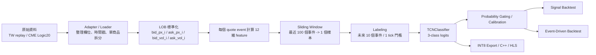

# 教學 20：模型、Feature、訓練細節與線上部署落差總表

## 1. 這份文件的目的
這份文件是專案目前最完整的模型技術說明。

它回答下面這些常被追問的問題：

1. 模型到底吃的是什麼資料？
2. `tick`、`event`、`sample` 分別是什麼？
3. 模型是不是每個 tick 都跑一次？
4. 12 維 feature 是哪些，為什麼選它們？
5. label 怎麼定義？有沒有 label leakage？
6. loss function、optimizer、class imbalance 怎麼處理？
7. evaluation metric 為什麼不能只看 accuracy？
8. offline 訓練和 online 部署之間有哪些 mismatch？

---

## 2. 先把名詞講清楚

### 2.1 價格 tick
這裡的 `tick` 指的是商品最小價格跳動單位。

例如：
- `+1 tick`
- `-1 tick`

在本專案中，`threshold_ticks = 1.0` 指的就是價格標籤門檻，而不是時間步數。

### 2.2 市場事件 event
這裡的 `event` 指的是一筆高頻市場資料更新。

在目前資料流裡，常見有兩種：
- `quote event`：委託簿快照更新
- `trade event`：成交紀錄

### 2.3 模型事件 model event
模型真正使用的主時鐘，是保留下來的 `quote / LOB snapshot event`。

也就是說：
- quote event 構成模型的時間軸
- trade event 不直接變成時間步
- trade event 會被對齊到 quote event，轉成成交流特徵

### 2.4 樣本 sample
一個 sample 不是一筆事件，而是一個滑動視窗：

> 最近 `100` 個事件組成一個 `(100, 12)` 樣本

因此這個專案的基本單位不是 K 棒，而是：

> event-level / tick-level LOB sequence

---

## 3. 模型是不是每個 tick 都跑一次？

### 3.1 理論上的線上系統
如果是未來真正的 streaming inference 系統，最自然的做法是：

1. 每來一筆新的有效 quote event
2. 更新當下的 12 維特徵
3. 推進長度 `100` 的 ring buffer
4. 跑一次 TCN inference
5. 把機率交給 gate / quote / trade 模組

也就是說，理論上可以做到：

> 每個新的有效事件都推論一次

### 3.2 目前離線研究流程
但目前離線研究不是每個原始 update 都跑，因為前處理還有抽樣與去重：

- `quote_stride`
  - 每隔幾筆 quote 才保留一筆
- `dedupe_quotes`
  - 如果整個 book 沒變，就不保留
- `sample_stride`
  - 不是每個可形成的 window 都拿去訓練，而是每隔幾個 sample 才取一個

所以現在比較精確的說法是：

> 模型目前是以 event-level 資料為基礎，但在離線研究中會先做去重與抽樣，並不是每個原始 market update 都直接送進 TCN。

---

## 4. 完整資料流程

---

## 5. 模型輸入特徵

### 5.1 目前主力 feature set
目前主力是 `execution_aware`，共 `12` 維：

1. `normalized_spread`
2. `micro_return`
3. `obi`
4. `weighted_mid_deviation`
5. `deep_obi`
6. `queue_imbalance`
7. `queue_imbalance_change`
8. `aggressor_imbalance_interval`
9. `rolling_signed_flow_ratio`
10. `trade_intensity_short`
11. `net_cancel_pressure`
12. `cancel_pressure_short`

### 5.2 這 12 維特徵的三個來源

#### 價格 / 價差
- `normalized_spread`
- `micro_return`
- `weighted_mid_deviation`

用途：
- 描述短期價格結構與價差寬度

#### 委託簿不平衡
- `obi`
- `deep_obi`
- `queue_imbalance`
- `queue_imbalance_change`

用途：
- 描述哪一邊的掛單壓力較大

#### 成交 / 撤單流
- `aggressor_imbalance_interval`
- `rolling_signed_flow_ratio`
- `trade_intensity_short`
- `net_cancel_pressure`
- `cancel_pressure_short`

用途：
- 描述是否有主動買賣壓力
- 是否有毒性流量
- 是否有流動性突然撤走

### 5.3 為什麼選這 12 維
選這組特徵的理由有三個：

1. 它們直接對應市場微觀結構，不是一般技術指標。
2. 它們大多可在 streaming 條件下即時計算。
3. 它們同時覆蓋 price、book、flow 三種核心資訊。

---

## 6. Normalization 與尺度設計

### 6.1 已經有做的 normalization
目前最主要的 normalization 是：

- spread 用 `tick_size` 正規化
- micro return 用 `tick_size` 正規化
- OBI 類特徵本身就是比例值
- cancel / flow / imbalance 類特徵盡量做成比率或相對量

換句話說，目前主軸是：

> 優先做微觀結構意義上的無因次化，而不是機器學習常見的全域 z-score standardization

### 6.2 目前沒有做的 normalization
目前沒有做：
- train-set mean/std normalization
- per-symbol z-score normalization
- online running normalization

這是刻意的，因為：
- 未來硬體上要帶一套 normalization 參數會更麻煩
- 我們希望特徵本身盡量具有跨商品可比性

### 6.3 這樣做的代價
缺點是：
- 某些 flow 類特徵的分布仍可能在不同商品間差很多
- `TW -> CME` transfer 會更容易出現 domain shift

所以目前的結論是：

> 我們已經做了第一層微觀結構 normalization，但若未來要提升跨市場泛化，仍可能需要更進一步的 per-symbol 或 streaming normalization 設計。

---

## 7. Label 定義

### 7.1 目前 label 的定義
label 不是看固定幾秒後，而是看固定幾個事件後。

目前主線設定是：
- `window_size = 100`
- `horizon = 10`
- `threshold_ticks = 1.0`

意思是：
- 模型看最近 `100` 個事件
- 用視窗最後一個事件作為決策時點
- 去看未來第 `10` 個事件後的 mid-price
- 若漲超過 `1 tick` -> `Up`
- 若跌超過 `1 tick` -> `Down`
- 否則 -> `Stationary`

### 7.2 這樣做的原因
這樣設計是為了：
- 避開超高頻資料過於細碎的 noise
- 讓模型學的是極短期方向，而不是單一 event 的抖動
- 保持與未來 event-driven 策略的一致性

---

## 8. TCN 模型結構

### 8.1 架構摘要
目前主模型是 `TCNClassifier`：

- 輸入 shape：`(Batch, 100, 12)`
- 先轉成 `(Batch, 12, 100)`
- 3 個 causal temporal block
- dilation：`1, 2, 4`
- channel：`[16, 16, 16]`
- kernel size：`3`
- dropout：`0.1`
- global average pooling
- final linear classifier
- 輸出 `3` 類：`Down / Stationary / Up`

### 8.2 為什麼選 TCN
選 TCN 而不是 LSTM / Transformer 的原因：

1. 因果卷積天然符合時間序列因果性。
2. dilation 可以用較少參數看到較長歷史。
3. 結構固定，對 C++ / HLS / FPGA 比較友善。
4. 輸入 shape 固定，容易做 pipeline 與 ring buffer。

### 8.3 目前模型大小
- 參數量：`4,771`
- 每樣本 MAC：`460,848`
- receptive field：約 `29 events`

這顆模型不是追求極致準確率的大模型，而是：

> 一顆小而固定、適合低延遲硬體部署的微觀結構分類器

---

## 9. Loss function 與訓練目標

### 9.1 現在用的 loss
目前主訓練目標是：

> `weighted CrossEntropyLoss`

實作上：
- `CrossEntropyLoss(reduction="none")`
- 先拿到每個 sample 的 loss
- 再乘上 `sample_weight`
- 最後除以 batch 內總權重

### 9.2 這代表什麼
它不是純粹的標準平均 cross entropy，而是：

> 可以同時整合 class imbalance 與樣本重要度的加權分類 loss

### 9.3 為什麼目前先用分類 loss
原因是：
- 比直接做 regression 更穩
- 對 early-stage baseline 容易訓練
- 方便配合 probability gating 轉成交易訊號

但也要知道：

> 這個 loss 最終優化的是分類，不是直接優化 PnL

這就是之後常見的 objective mismatch 來源。

---

## 10. Optimizer 與訓練超參數

### 10.1 目前主線訓練器
目前訓練器使用：
- optimizer：`Adam`
- learning rate：`1e-3`
- weight decay：`1e-4`
- batch size：`256`
- patience：`2`
- epochs：通常 `6`

### 10.2 Early stopping
目前 early stopping 是看：

> `validation loss`

當 validation loss 不再改善時，就停止訓練並回復最佳權重。

### 10.3 目前沒有做的訓練技巧
目前沒有做：
- scheduler
- gradient clipping
- QAT
- PnL-aware differentiable loss

所以目前這一版仍屬於：

> 結構清楚、可重現、偏 baseline 的 supervised training setup

---

## 11. Class imbalance 怎麼處理

### 11.1 問題來源
在高頻資料裡，`Stationary` 往往遠多於 `Up` 和 `Down`。

如果不處理，模型很容易學成：
- 幾乎都預測 `Stationary`
- accuracy 看起來不錯
- 但沒有可交易 edge

### 11.2 第一層：class weight
目前訓練器會先根據 train split 的類別數量，計算反比型的 `class_weights`。

這樣可以讓：
- 少數類別 `Up / Down`
- 在 loss 裡得到較大權重

### 11.3 第二層：sample weight
除了 class weight，dataset 還支援 `sample_weight`，可以進一步對：
- 非 `Stationary` 樣本加權
- 特定商品加權
- 報酬幅度較大的樣本加權

### 11.4 這樣做的副作用
如果權重設太激進，模型會：
- 變得更願意出方向
- trade 數增加
- 但 false positive 也可能變多

所以 class imbalance 的處理，實際上是在：

> 「不塌成全 stationary」和「不要過度交易」之間找平衡

---

## 12. Evaluation metric

### 12.1 分類指標
目前分類指標包括：
- `accuracy`
- `macro_precision`
- `macro_recall`
- `macro_f1`
- `confusion_matrix`
- `per_class precision/recall/f1`

其中最重要的是：

> `macro_f1`

因為它比單純 accuracy 更能看出少數類別有沒有真的學到。

### 12.2 為什麼 accuracy 不夠
因為在高頻資料中：
- `Stationary` 往往很多
- 只靠預測 `Stationary` 就可能拿到不錯 accuracy
- 但交易結果可能仍然很差

### 12.3 交易評估指標
因此目前還會看：
- signal backtest
- event-driven backtest

常用指標有：
- `net_pnl_ticks`
- `win_rate`
- `avg_pnl_ticks`
- `avg_holding_steps`
- `sharpe_like`

這也是為什麼目前專案的核心態度是：

> 分類 metrics 是必要條件，但不是最終答案

---

## 13. Label leakage 與資料切分風險

### 13.1 目前做對的部分
目前主體流程是 causal 的：
- 輸入只使用當下與過去事件
- label 才看未來 `horizon` 事件
- TCN 使用 causal convolution，不偷看未來
- train / val / test 也是按時間順序切

### 13.2 目前仍需誠實面對的風險

#### 風險 1：rolling volatility 的 `bfill`
目前某些 rolling 特徵在前段缺值處理時使用了 `.bfill()`。

這代表最開頭少量樣本，會把未來值往前補，屬於：

> 輕微但真實存在的 leakage

#### 風險 2：先做 sliding window，再切 split
目前資料切分是針對 window 後的 dataset 做 chronological split。

這雖然仍是時間順序，但會導致 split 邊界附近樣本：
- 高度重疊
- 共用大量歷史事件

這不等於直接偷看 future label，但屬於：

> cross-split contamination 風險

#### 風險 3：validation-based calibration 若做太多次
如果在 validation 上反覆調規則與門檻，也可能造成：
- 過度擬合 validation
- 過度樂觀的策略表現

### 13.3 下一步怎麼改善
未來更嚴謹的版本應該做：
- rolling 特徵改用前向安全填補，不用 `bfill`
- 在 raw event 層先切 train/val/test
- 在 split 間加入 purge gap
- 更嚴格的 walk-forward evaluation

---

## 14. Offline 訓練與 Online 部署的 mismatch

### 14.1 抽樣與去重 mismatch
目前離線資料常會做：
- `quote_stride`
- `sample_stride`
- `dedupe_quotes`

但未來線上系統若要每個有效事件都推論，就必須確保：
- 線上前處理跟離線完全一致
- 否則會出現 train-serving skew

### 14.2 特徵聚合 mismatch
目前 trade / cancel 類特徵，是離線先對齊到 quote event 算出來的。

未來線上若要部署，前端必須即時計算出一模一樣的：
- `aggressor_imbalance_interval`
- `trade_intensity_short`
- `cancel_pressure_short`

否則：
- 模型輸入分布會改變

### 14.3 目標函數 mismatch
目前訓練優化的是 classification loss，不是 PnL。

所以很可能發生：
- macro F1 變好
- 但交易結果沒有變好

### 14.4 成交模型 mismatch
目前 event-driven backtest 雖然比 signal-level 更真實，但仍然是近似。

線上真實市場還會多出：
- queue priority 更細節的影響
- feed latency
- order management latency
- 實際成交與滑價差異

因此目前更準確的說法是：

> 這個專案已經從 offline classifier 走到「可接近線上 execution」的研究原型，但還沒有完全消除 offline-online mismatch。

---

## 15. Train / Inference / Execution 三層要分開看

### 15.1 Train layer
負責：
- supervised learning
- loss minimization
- class imbalance 處理
- model selection

### 15.2 Inference layer
負責：
- 接收最近 `100 x 12` 視窗
- 輸出 `Down / Stationary / Up` 機率

### 15.3 Execution layer
負責：
- probability gating
- quote on/off
- event-driven trade decision
- hybrid MM / inventory / toxicity guard

這三層不能混為一談。

目前常見誤解是：
- 把 classifier 的 accuracy 當成策略績效
- 或把交易器規則改善，誤認成模型本身進步

更正確的說法是：

> classifier 提供 alpha 候選，execution layer 決定這個 alpha 能不能活著變成 PnL。

---

## 16. 目前這顆模型的優點
1. 架構小、固定、適合硬體。
2. feature 有明確微觀結構意義。
3. event-level 表示法比 K 棒更符合高頻場景。
4. 已有完整的 signal / event-driven / hardware handoff 流程。

---

## 17. 目前最重要的限制
1. feature normalization 仍不夠完整，跨市場泛化有限。
2. class imbalance 與 objective mismatch 仍會影響交易結果。
3. 少量 leakage / contamination 風險還沒完全清掉。
4. online streaming 與 offline dataset 間仍有工程落差。

---

## 18. 一段可以直接報告的標準說法
你可以直接這樣講：

> 目前的模型是一個 event-level 的三分類 TCN。時間軸不是秒 K，而是委託簿事件；每個事件會被轉成 12 維微觀結構特徵，最近 100 個事件形成一個輸入視窗，模型預測未來 10 個事件後 mid-price 是上漲、下跌還是持平，其中持平門檻是 1 個價格 tick。訓練上使用加權 CrossEntropyLoss 與 Adam，並透過 class weight 和 sample weight 緩解 stationary 類別過多的問題。評估時除了 accuracy 和 macro-F1，也會看 signal backtest 與 event-driven backtest，因為分類表現不等於交易表現。整體流程目前是 causal 的，但仍有少量 leakage 與 offline-online mismatch 需要進一步清理，這也是後續真正推向 HLS/FPGA 前的重要工程工作。 
